# 阶段三（edge 原生防御）阶段性总结报告

> **写于 2026-11-03；11-07 更新（缓存池、先例文献）；2026-11-24 第二次大更新**（方向 2、补充实验、离线探针、攻击基线接线、实验设定与超参数、全部结果图）。
> 这是**阶段性**报告，不是终版：攻击基线（§10）还在进行。
> 本文件是**汇总**，不新算结论：所有数字取自本目录 `FINDINGS.md`（F-087 … F-138）、`DECISIONS.md`（D-089 … D-141）、预注册规则 N-008 … N-016、
> `analysis/*.json`、`experiments/thesis/analysis/defense_balance.md`；超参数取自生成的配置 `configs/<run_id>.yaml`。与 FINDINGS 不一致时以 FINDINGS 与判定脚本为准。
> 图全部来自 `experiments/thesis/figures/`（`python3 harness/thesis_figures.py` 生成；图上的数与判定文件同源，`tests/test_thesis_figures.py` 逐项钉住）。
> **图内文字是英文**（论文用图），每张图下面有中文图注；逐图的英文图注草稿与改图入口见 `experiments/thesis/FIGURE-NOTES.md`。
> 路径相对仓库根，本目录 = `experiments/defense/edge-native/`。分支：阶段三的实验全部做完之前不合并到 main（用户 2026-10-10）。
> 文中第一次出现的组名、标签都会说明含义；组名汇总见附 B，术语见附 C。

---

## 目录

0. [现状](#0-现状2026-11-24)（[0.1 结果图一览](#01-结果图一览)）
1. [一页摘要](#1-一页摘要)
2. [研究问题与回答状态](#2-研究问题与回答状态)
3. [出发点、实验设定与超参数](#3-出发点实验设定与超参数)
4. [上传前加固（已结案）](#4-上传前加固已结案)
5. [CCS 线（已结案，不分层设置）](#5-ccs-线已结案不分层设置)
6. [方向 2：边缘干净集作参照（已停止）](#6-方向-2边缘干净集作参照已停止)
7. [边缘级共享块（三层个性化）：主结论与补充实验](#7-边缘级共享块三层个性化主结论与补充实验)
8. [已知防御基线：逐坐标中位数](#8-已知防御基线逐坐标中位数)
9. [综合比较与灌入—洗掉分解](#9-综合比较与灌入洗掉分解)
10. [攻击基线（进行中）](#10-攻击基线进行中)
11. [用户的追问与现有回答](#11-用户的追问与现有回答)
12. [没做的与下一步](#12-没做的与下一步)
13. [局限与已知问题](#13-局限与已知问题)
14. [机时](#14-机时)
- [附 A：判定文件与数据索引](#附-a判定文件与数据索引) · [附 B：实验组总表](#附-b实验组总表) · [附 C：术语表](#附-c术语表)

---

## 0. 现状（2026-11-24）

- **最有效的边缘防御是「边缘级共享块」**（也叫三层个性化：ResNet-10 的最后一个残差块只在边缘服务器内部平均、不上云）。
  攻击者集中在一台边缘时，三台受害边缘的良性端攻击成功率从 0.996 降到 0.281，主任务精度只降 0.002（3 个种子；两种划分结果一致）。
- 它是**按边缘的隔离**：边缘里只要有 1 个攻击者，这台边缘就和攻击者所在边缘一样失守（[9,1,0,0] 布点，预注册判定 `clean_protected` + `e1_breached`）；
  攻击者分散在每台边缘时无效。它**不只是「少共享」**：隔离 1 块比「几乎完全不上云」多保住 0.018–0.022 的精度（预注册判 `inconclusive`，报数字不报方向）。
- 机制上：受害边缘剩下的攻击成功率就是**传过去的那部分后门**（在受害者自己的模型上求扰动也不更强，`not_transmitted`）；
  「后门主要存在最后一块」这一前提**没能验证**（两次重训探针都定位不了：不打坏模型就清不掉后门）。
- **其余三条防御线都已结案**：上传前加固（保护受害边缘、碰不到攻击者所在边缘）；CCS 线（不分层设置下只开统计量聚类精度代价小但防御不可靠）；
  方向 2 参照过滤（只打分时分得开，在线过滤只能把后门削弱到约 0.5–0.6，分数滞后于后门形成反馈循环；组内更同质的划分陷入冷启动死锁）。
- 已知防御基线**逐坐标中位数**（边缘层 / 云层）几乎无效：受害边缘仍在 0.89–0.99。
- **现在在做**：攻击基线第一档（BadNets / Blended / DBA）已接到主实验的取数路径，**探路组 ATKP 还没在集群上提交**（§10、§12.1）；时间盒 2026-12-06。
  除此之外没有待交、待回传的作业。

### 0.1 结果图一览

全部在 `experiments/thesis/figures/`（PDF 矢量版 + 300 dpi PNG）。

| 图 | 回答什么 | 小节 |
|---|---|---|
| [图 4.1 划分的异质性](../../thesis/figures/fig4_1_partition.png) | 边缘内是否比边缘间更同质；组内更同质变体差多少 | §3.4 / §6.2 |
| [图 4.2 灌入—洗掉示意](../../thesis/figures/fig4_2_decomposition.png) | 「灌入」「洗掉」「净增量」在一条真实轨迹上是什么 | §3.1 |
| [图 5.1 触发器底线](../../thesis/figures/fig5_1_floor.png) | 不投毒时同一触发器有多高（阶段二） | §3.1 |
| [图 5.2 植入不受收敛门控](../../thesis/figures/fig5_2_gating.png) | 训练后期开始投毒是否更难植入（阶段二） | §3.1 |
| [图 5.3 云周期内的锯齿](../../thesis/figures/fig5_3_sawtooth.png) | 云聚合灌入 vs 边缘内洗掉（阶段二） | §3.1 |
| [图 5.4 攻击者离开后的衰减](../../thesis/figures/fig5_4_decay.png) | 攻击者走后后门怎样褪去（阶段二） | §3.1 |
| [图 5.5 边缘视角的可观测性](../../thesis/figures/fig5_5_observability.png) | 边缘服务器能否从单个上传看出攻击者（阶段二） | §3.1 |
| [图 6.1 边缘级共享块：轨迹](../../thesis/figures/fig6_1_edge_shared_block.png) | 隔离最后一块对受害边缘 / 攻击者所在边缘的作用 | §7.1 |
| [图 6.1b 白盒触发器](../../thesis/figures/fig6_1b_whitebox_transfer.png) | 受害边缘剩下的攻击成功率从哪来 | §7.5 |
| [图 6.2 共享深度的权衡](../../thesis/figures/fig6_2_sharing_depth.png) | 隔离 0 / 1 / 2 / 4 块：安全与精度的代价 | §7.3 |
| [图 6.3 威胁边界](../../thesis/figures/fig6_3_threat_boundary.png) | 边缘里有 1 个攻击者时隔离还剩多少 | §7.4 |
| [图 6.4 上传前加固](../../thesis/figures/fig6_4_hardening.png) | 离线筛选 36 个配置 + 在线轨迹 | §4 |
| [图 6.5 不分层统计量聚类](../../thesis/figures/fig6_5_flat_clustering.png) | CCS 两个组件与缓存池的效果 / 代价 | §5 |
| [图 6.6 参照打分的可分性](../../thesis/figures/fig6_6_reference_scoring.png) | 只打分时各分数能否分开攻击者 | §6.3 |
| [图 6.7 在线过滤与反馈循环](../../thesis/figures/fig6_7_filtering_feedback.png) | 过滤后的轨迹；攻击者分数随后门强度变化 | §6.4 / §6.6 |
| [图 6.7b 统计量偏移随后门强度](../../thesis/figures/fig6_7b_shift_vs_strength.png) | 反馈循环的直接证据（108 个边缘模型） | §6.6 |
| [图 6.8 良性端的误判分布](../../thesis/figures/fig6_8_benign_misjudgement.png) | 参照过滤误伤落在谁身上 | §6.7 |
| [图 6.9 综合比较](../../thesis/figures/fig6_9_comparison.png) | 全部防御的效果、精度代价、计算量 | §8 / §9 |
| [图 6.10 灌入—洗掉按防御分解](../../thesis/figures/fig6_10_injection_washing.png) | 每种防御作用在灌入还是净增量 | §4.4 / §9 |
| [图 A.1 重训探针](../../thesis/figures/figA_1_retraining_probe.png) | 能否定位后门在哪一层 | §7.6 |

还没有的图：示意图 1.1（系统与防御位置）、触发器图库 2.1、较弱攻击下的结果 6.11（等攻击基线数据）。

---

## 1. 一页摘要

证据强度（同 `experiments/thesis/OUTLINE.md` §四）：**强** = 预注册判定 + ≥ 3 个种子；**中** = 3 个种子但只是描述性，或判定脚本写于数据之后；**弱** = 单种子或只有相关性；**无** = 没有证据。

| # | 结论 | 证据强度 | 出处 |
|---|---|---|---|
| 1 | **边缘级共享块**在攻击者集中时把受害边缘从 0.996 压到 0.281（主划分）/ 0.911 → 0.302（组内更同质划分），主任务精度降 0.002；攻击者所在边缘的良性端不受保护（0.988）；分散布点无效（0.956） | 强（旧划分有预注册判定 `blocks`；新划分 3 种子描述性对照） | §7.1，阶段二 F-077 |
| 2 | 这不是「少共享」的平凡后果：隔离 1 块比几乎完全不上云（隔离 4 块，只剩 0.14% 参数上云）多保住 0.020 / 0.022 / 0.018 的精度 → 预注册判 `inconclusive`（种子 44 差一点没到 0.02） | 中（报数字不报方向） | §7.3，F-130 |
| 3 | 隔离是**按边缘**的：[9,1,0,0] 下两台干净边缘降 0.61–0.68（`clean_protected`），有 1 个攻击者的边缘仍 0.93–1.00（`e1_breached`） | 强 | §7.4，F-131 |
| 4 | 三层个性化的结构在真实快照上成立：上云段 = 四台边缘的等权平均，边缘段从未上云 | 强（结构核查） | §7.2，F-133 |
| 5 | 受害边缘剩下的约 0.3–0.4 是**传过去的那部分后门**：在受害者自己的模型上求扰动反而略低（−0.072 / −0.011 / −0.068）→ `not_transmitted` | 强 | §7.5，F-135 |
| 6 | 「后门主要存在最后一块」**未验证**：两次重训探针都定位不了（第一次阳性对照也是 0；追加探针 12 档里没有一档能在精度降 ≤ 0.05 的约束下清掉后门 → `not_removable`） | 无 | §7.6，F-134 / F-137 |
| 7 | **上传前加固**（边缘服务器每个云轮末用 500 张干净图做对抗式反学习）保护受害边缘：降 0.476 / 0.522 / 0.228，精度降 0.009–0.015；碰不到攻击者所在边缘（`no_effect`）；离线筛选判 `accuracy_bound`（削得动灌入的配置都过不了精度门槛） | 强 | §4，F-100 / F-104 |
| 8 | 上传前加固不是靠减少每次灌入，而是靠缩小每周期的净增量 | 中（探索性，看过数据之后才算） | §4.4，F-124 |
| 9 | **CCS 线**（不分层）：只开统计量聚类精度代价小且稳（降 0.008–0.016），防御刚过线、5 个种子 2 个失守；对抗训练让训练随机崩溃；缓存池修好两个失守种子，代价 0.026 / 0.028（`no_fix`，用户事后接受） | 强 | §5，F-118 … F-120 |
| 10 | 「用 BatchNorm 统计量检测恶意客户端」已有 BNGuard、CCS 两篇先例（都不分层）；方向 2 最近的先例是 FoggyTrust（分层、模型投毒、不个性化） | 文献（未读全的标 provisional） | §6.1，F-121 / F-122 |
| 11 | **参照打分**（边缘服务器用自己 500 张干净图给每个上传打分）只打分时可行：主划分四格最小 AUROC 0.847，组内更同质划分 0.895 → 两个划分都 `feasible`；分散布点是短板 | 中（预注册，每格单种子） | §6.3，F-126 |
| 12 | **在线过滤只能削弱后门**：主划分受害边缘 0.996 → 0.536（过滤 + 共享块 0.184）；只有「共享块开 + 分散布点」一格过全部门槛（`protects`），不隔离的两格 `accuracy_bound`（精度降 0.021 / 0.024） | 强 | §6.4，F-128 |
| 13 | 组内更同质划分的过滤是**冷启动死锁**：第 1 轮分数全部超阈值 → 全部丢弃 → 模型 300 轮一次没更新；原因 = 分数选择 + 全程固定阈值 + 「全丢则不更新」，与干净集无关 | 强（诊断） | §6.5，F-128 |
| 14 | 参照分数**滞后于后门**：过滤一开，攻击者分数就跟着「上一云轮的后门强度」走（相关 0.07 → 0.57）；离线 108 个边缘模型上「触发器引起的统计量偏移」与后门强度 Spearman 0.911（`feedback_moderate`） | 中（相关性证据） | §6.6，F-129 / F-136 |
| 15 | 参照过滤的误判集中在少数良性端：多数很少被丢，少数被丢一半以上 | 中（描述性） | §6.7 |
| 16 | **逐坐标中位数**（边缘层 / 云层）几乎无效：按事先规则三格判 `blocks` 只因方向一致，效应量 0.004–0.10；集中布点比共享块高 0.6 以上 | 强（带效应量） | §8，F-132 |
| 17 | 灌入—洗掉分解：共享块主要砍灌入（前半程 0.220 / 0.222 / 0.148 → 0.035 / 0.072 / 0.071）；加固按攻击成功率看几乎不砍灌入、按 margin 看砍约三分之一 | 中（描述性） | §9 |
| 18 | 攻击基线第一档（静态三种攻击）已接线，本地测试全过；**GPU 上的确定性与显存还没有证据** | — | §10，F-138 |

---

## 2. 研究问题与回答状态

阶段三计划（`PLAN.md` §2.1）列了 9 个问题。论文里它们并进 RQ3「边缘侧能做什么防御、有效边界在哪、代价多少」（第 6 章：6.1 共享块、6.2 加固、6.3 检测线、6.4 综合比较、6.5 其他攻击）。

| 编号 | 问题（简写） | 状态 | 现在的回答 |
|---|---|---|---|
| D1 | 边缘上传前用干净图做对抗训练，能否让每次灌入小于周期内洗掉的量？ | **部分** | 离线：削得动灌入的配置都过不了精度门槛（F-100）。在线：灌入基本不变，但每周期净增量变小、受害端被压低（F-104 / F-124）—— 起作用的方式不是计划设想的那种 |
| D2 | 一直开着的在线加固能否让干净边缘保持干净（集中布点）？ | **已回答（3 种子）** | 部分能：受害端平均降 0.41，种子 44 仍 0.77；没有不投毒的下限实验，不能写「清除」 |
| D3 | 能否保护分散布点、攻击者所在边缘内的良性端？ | **部分（多为负面）** | 加固、共享块、中位数都碰不到攻击者所在边缘；只有参照过滤碰得到（0.999 → 0.781），但同时精度降 0.021、判 `accuracy_bound`（F-128） |
| D4 | 对抗训练放在客户端 / 边缘 / 云 / 不分层服务器，各自的效果与代价？ | **未开始** | 云侧、不分层的对抗训练对照都没跑（云层只做了中位数，§8） |
| D5 | CCS 两个组件各贡献多少？ | **部分（不分层设置）** | 聚类：精度代价小、防御不可靠；对抗训练：让训练随机崩溃（F-118 / F-119）。分层设置下没做 |
| D6 | 换成知道防御的攻击者，防御还剩多少？ | **未开始** | 排在攻击基线第 ②½ 档：「知道最后一块不上云」的 Bad-PFL 攻击者最小版（§10.5） |
| D7 | 与边缘级共享块组合：叠加还是冗余？ | **部分** | 参照过滤 + 共享块：集中布点 `additive`（0.286 vs 只开共享块 0.399），分散布点 `redundant`（F-128）；共享块面对「知道分段」的攻击者没测 |
| D8 | 效果是否只对 Bad-PFL 这种对抗扰动式触发器成立？ | **进行中** | 静态三种攻击接线完成，等探路组 ATKP（§10） |
| D9 | 比已知防御好吗？ | **部分** | 逐坐标中位数（边缘层 / 云层）几乎无效（F-132）；FLAME、Multi-Krum 没跑（本仓库的 FLAME 没按文献修好，`CLAUDE.md` 陷阱 #2 / #3） |

---

## 3. 出发点、实验设定与超参数

### 3.1 阶段二回顾（阶段三的出发点）

阶段二（Experiment 3 改版，终版报告 [`experiments/attack/hfl-mechanism/REPORT.md`](../../attack/hfl-mechanism/REPORT.md)，2026-10-03）在同一套主实验协议下刻画了 Bad-PFL 在「云—边缘—客户端」三层个性化联邦学习里的行为：

| 子实验 | 结论 | 强度 | 图 |
|---|---|---|---|
| 触发器底线 | 攻击者不投毒时同一触发器只有 0.04–0.10 → 有攻击时的高平台**不是**触发扰动本身的对抗效应；底线随本边缘目标类占比变化 | 强 | 图 5.1 |
| 收敛门控 | `not_gated`：无论第几轮开始投毒，攻击者所在边缘的良性端都立刻被攻破（窗口内峰值 0.62–0.96） | 强 | 图 5.2 |
| 云周期内的锯齿 | 受害边缘在两次云聚合之间会自己洗掉一部分后门，但每次云聚合灌进来的更多（灌入 0.197 / 0.268 / 0.180，周期 5 / 10 / 20 个边缘轮）→ 走向饱和 | 强（4 / 5 格 `self_cleaning`） | 图 4.2、5.3 |
| 衰减 | 攻击者停止后约 200 个有效轮褪回底线附近、留少数长尾；不分层也一样 | 中（落在「由用户决定」分支） | 图 5.4 |
| 可观测性 | 对单个上传，边缘视角与等大小的全局随机视角分辨力一样（`no_edge_gain` / `undetectable`）；最强信号是批归一化统计量的范数（AUROC 0.905），但它可以零代价伪造 | 强 | 图 5.5 |
| 三层个性化（旧划分） | 攻击者集中时隔离最后 1 / 2 块把受害边缘降 0.52 / 0.73、精度代价 ≤ 0.02 → `blocks`；分散布点无效 | 强 | — |

**对阶段三的含义**：干预必须**一直开着**、作用在**云聚合之前**；单更新检测在边缘没有依据 → 阶段三先做非检测型的边缘防御（上传前加固），再试检测线（CCS、参照打分），并把三层个性化当作一条防御来检验。

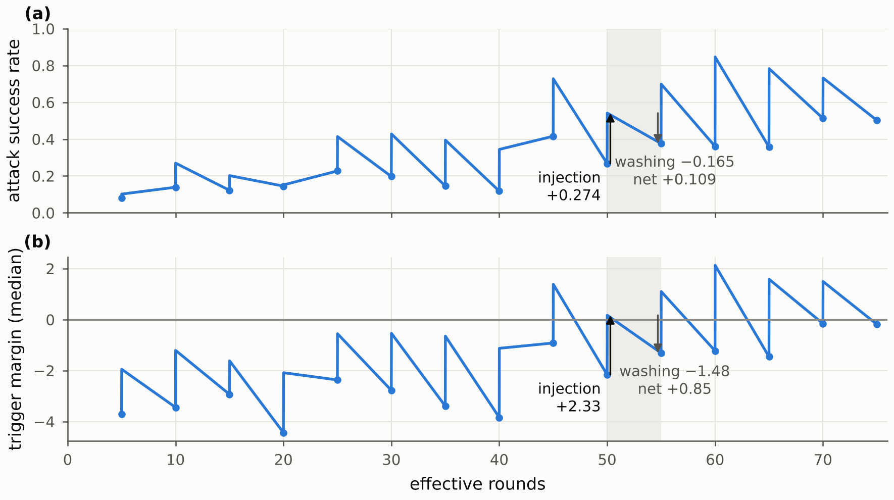

**图 4.2 灌入—洗掉分解示意**（不设防、集中布点、种子 42，三台受害边缘平均，前 15 个云轮）。(a) 攻击成功率，(b) margin（触发样本「目标类对数概率 − 其余类最大对数概率」的中位数）。
每个竖直线段 = 一次云聚合把后门**灌入**受害边缘；两次云聚合之间的斜坡 = 边缘内训练**洗掉**一部分；圆点 = 云轮末的评估点；灰底 = 标注的第 11 云轮：灌入 +0.274、洗掉 −0.165、净增量 +0.109（margin 口径 +2.33 / −1.48 / +0.85）。
净增量为正就一个周期一个周期地走向饱和。这是单种子的定义图；全书的灌入 / 洗掉数字见 §9。

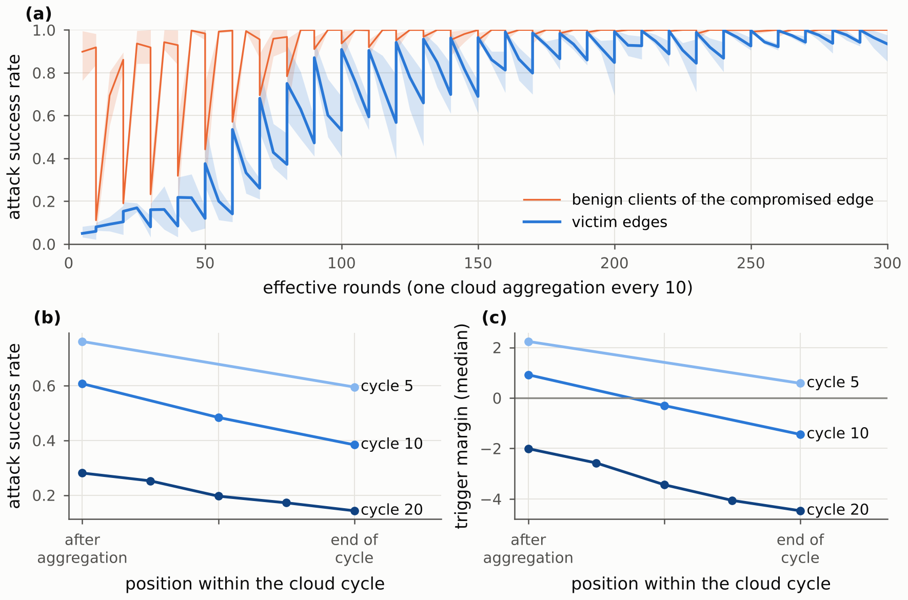

**图 5.3 云周期内的锯齿**（阶段二，主划分、集中布点、3 种子）。(a) 每 10 个边缘轮一次云聚合时的完整轨迹：蓝 = 受害边缘，橙 = 攻击者所在边缘的良性端（云聚合时被三台干净边缘稀释、往下掉）；浅色带 = 种子范围。
(b)(c) 一个云周期内的相位剖面（前半程平均），攻击成功率与 margin，三条线 = 周期 5 / 10 / 20 个边缘轮（三条线覆盖的训练阶段不同，高低不能直接比）。
每次云聚合灌入均值 0.197 / 0.268 / 0.180，每周期洗掉 0.166 / 0.223 / 0.138 → 洗不过灌。

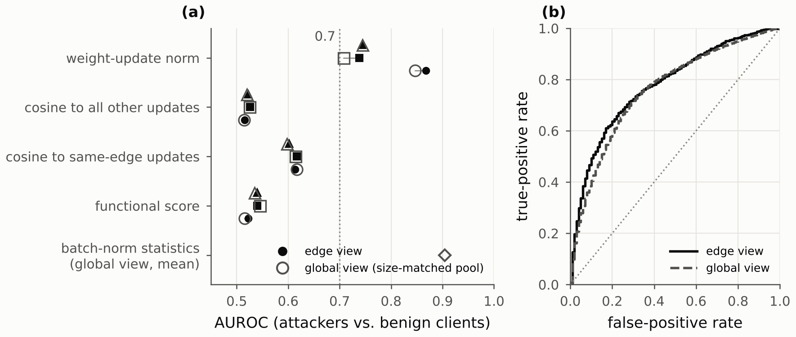

**图 5.5 边缘视角的可观测性**（阶段二，分散布点、每 10 个边缘轮一次云聚合、3 种子）。(a) 各检测量分开攻击者与良性上传的 AUROC：实心 = 边缘视角（用本边缘的上传作参照），空心环 = 全局视角（等大小的全局随机样本）；每个种子一种形状（圆 42、方 43、三角 44，上下错开）；最后一行 = 批归一化统计量范数（只有全局视角的均值）；点线 = 事先定的可检测下限 0.7。
(b) 权重更新范数的 ROC，边缘视角（实线）vs 全局视角（虚线）。权重范数边缘 0.87 / 0.74 / 0.74 vs 全局 0.85 / 0.71 / 0.74；余弦与功能分数都在 0.51–0.62。

### 3.2 配置从哪来

每个 run 的配置由一条固定的链生成，**不手写**：

1. `experiments/attack/hfl-mechanism/base.yaml`（阶段二的基配置）；
2. 叠加**主实验协议模板** `fedavg/config/alignment_p2.yaml`（内部叫「P2 口径」）：与官方 Bad-PFL 实现逐条对齐后定下的全部开关，`config_validate` 对标了 P2 的配置逐键核对，少开一项就拒绝启动；
3. 本目录 `registry.yaml` 的公共底座 `d_base`（4 台边缘、机构式划分、60 云轮、评估网格等）与各组的 `set:`（只写这一组改的键）；
4. `python3 harness/registry.py experiments/defense/edge-native/registry.yaml --materialize` 生成 `configs/<run_id>.yaml`（每个 run 一份；`harness/status.py` 用 yaml 原文的 hash 对账，回传结果的配置变了会标出来）。

主实验协议模板逐项的含义：

| 开关 | 取值 | 含义 |
|---|---|---|
| `training.deterministic_ops` | true | 打开 TensorFlow 确定性算子；每轮打印模型校验和 `[Checksum]` |
| `training.fedrep_poison_phases` | body | FedRep 只在训练主干那一段投毒（分类头那段只见干净数据） |
| `training.fedrep_bn_stats` | private | 批归一化的缩放 / 平移参数共享，滑动均值 / 方差私有（客户端保留自己的副本；上传里仍带统计量，见 F-123） |
| `training.lr_round_axis` | effective | 学习率按**有效轮**（云轮 × 每云轮边缘轮数）衰减，不按云轮 |
| `data.batch_pipeline` | per_epoch | 每个 epoch 重新打乱、重新增强、丢掉不满的尾批 |
| `model.arch` | resnet10_torch | 与 torch 对齐的 ResNet-10（stride-2 卷积的补边、BN 动量与 epsilon、初始化），BN 的推理路径避开 GPU 确定性的坑（陷阱 #23） |
| `federation.edge_schedule` | interleaved | 外层是边缘轮、内层是各台边缘（各边缘交错推进，共享生成器的更新次序不偏） |
| `federation.quota_round_axis` | effective | 每台边缘的参与名额按有效轮轮转余数 |
| `backdoor.badpfl_xi` | pgd | 触发器的对抗噪声 ξ = 官方单步 PGD（随机起点 → 求梯度 → 投影） |
| `backdoor.eval_xi_model` | fixed_attacker | 评估时 ξ 在按种子固定选中的**一个攻击者**的模型上求（与官方一致） |
| `backdoor.poison_sampling` | bernoulli | 每张样本独立以投毒率决定是否投毒 |
| `backdoor.badpfl_bn_mode` / `badpfl_generator` | official | 生成器的结构、初始化、BN 模式照官方 |
| `evaluation.asr_columns` | four_way | 攻击成功率记四列（只数非目标类 / 全部 × 只看良性端 / 全部）；主指标 = 只数非目标类 × 只看良性端 |
| `evaluation.pm_model` | fresh | 主任务精度与攻击成功率都在「评估用新鲜个性化模型」上测（§3.7） |

### 3.3 计算环境与可复现性

- **集群**：Arrhenius，SLURM 提交，所有 Python 都在 apptainer 容器里跑（`cluster_env.sh` 解析出 `$PY`）。单卡显存约 96 GiB（`gpu.json` 的 `mem_total_mib` = 97 871）。
- **一卡多跑**：同一格子的 3 个种子装进一个作业并行（`hfl-mechanism/pack.sbatch`）；每个 run 实测显存峰值约 17 GiB、绑 4 个 CPU 核、申请 24 GiB 主机内存。
  CCS 格子主机内存约 31 GiB → 一卡 2 个、每 run 48 GiB。一个三跑包实测 3.9–4.4 小时墙钟（按 1 卡计 GPU 小时）。
- **确定性**：`enable_op_determinism()` + 每轮 `[Checksum]`；同配置同种子跨节点、跨作业逐位复现（阶段二 F-045），**前提是每个 run 恰好 4 个 CPU 核**（核数会改变结果）。
  每加一种「只记录」的仪表，都在 GPU 上验证过开 / 关的校验和逐轮相同（例：参照打分 F-126，k = 1 的只记录模式 F-130）。
- **种子**：主检验 42 / 43 / 44（按种子配对比较）；CCS 线只开聚类补到 45 / 46；不投毒的开发 run 用 41（参照打分的阈值只在它上面定）。

### 3.4 数据与划分

- **数据**：CIFAR-10。官方训练集与测试集合并成 60 000 张后再分给客户端（PFLlib 的做法；划分是一个**分割**，每张图只属于一个客户端，所以客户端的留出分片合起来与全部训练数据不相交，陷阱 #11）。
  每个客户端恰好 500 张 = **375 张训练 + 125 张留出**（客户端等大小、无放回）。
- **预处理**：逐通道标准化；增强 = 随机左右翻转 + 四周补 4 像素零后随机裁剪回 32×32；每个 epoch 重新打乱、重新增强、丢尾批（`data/epoch_pipeline.py`）。
- **主划分 = 机构式设计划分 C1**（`federation.partition: designed`，`data/designed_partition.py`）：

  | 边缘 | 类别比例 |
  |---|---|
  | E0 | 10 类各 0.10（均衡） |
  | E1 | 汽车、卡车各 0.25；猫、狗、鹿、马各 0.025；飞机、鸟、船、青蛙各 0.10 |
  | E2 | 猫、狗各 0.25；汽车、卡车、鹿、马各 0.025；飞机、鸟、船、青蛙各 0.10 |
  | E3 | 鹿、马各 0.25；汽车、卡车、猫、狗各 0.025；飞机、鸟、船、青蛙各 0.10 |

  偏斜 r = 0.25；目标类（飞机）在每台边缘都是 0.10。边缘内每个客户端的类比例 ~ Dirichlet(α_c · K · p_e)，α_c = 0.5（在均衡的 E0 上就是标准的 Dir(0.5)）。
  每台边缘另切出 **500 张与客户端不相交的干净集**（按本边缘分布；上传前加固与参照打分用它）。干净集按类排序，取子集一律分层抽样（F-095）。
- **组内更同质变体**（方向 2 用；D-130）：边缘层与干净集不变，边缘内第 c 个客户端 = (1 − λ)·本边缘分布 + λ·（第 c mod 5 对类各 0.5），λ = 0.4，客户端层不耗随机数。
- **CCS 线**用旧的逐类 Dirichlet 0.5 划分（CCS 原文的设定；客户端不等大，**没有边缘干净集**）。
- 实测异质性（3 种子均值，类分布的总变差，F-125）：

  | 划分 | 同边缘两端 | 跨边缘两端 | 比值 | 客户端 − 本边缘 | 边缘之间 |
  |---|---|---|---|---|---|
  | 主划分 C1 | 0.549 | 0.696 | 0.79 | 0.408 | 0.375 |
  | 组内更同质 λ = 0.4 | 0.296 | 0.547 | 0.54 | 0.271 | 0.375 |
  | 等大小随机（边缘不对应机构） | 0.610 | 0.608 | 1.00 | 0.453 | 0.134 |

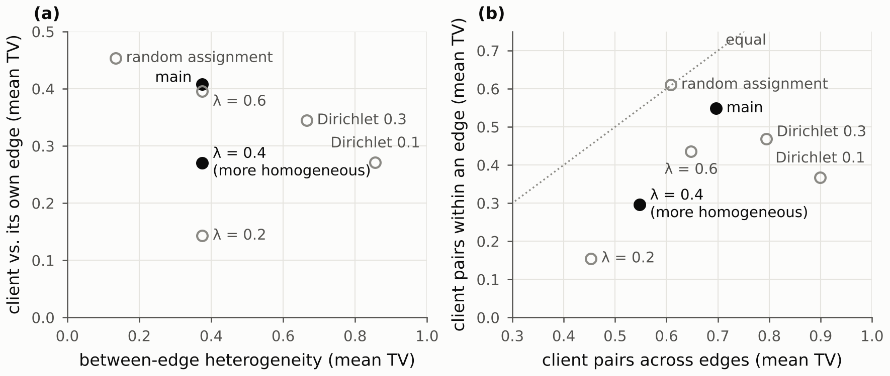

**图 4.1 数据划分的异质性**（3 种子均值，总变差：0 = 相同、1 = 完全不重叠）。(a) 横轴 = 边缘之间的差异，纵轴 = 客户端与本边缘的差异。(b) 横轴 = 跨边缘两个客户端的平均差异，纵轴 = 同边缘两个客户端的平均差异，落在虚线以下 = 边缘内更同质。
实心黑点 = 实验里真正用到的两种划分（主划分、λ = 0.4），空心灰点 = 参照划分。主划分的「组内更同质」体现得较弱（每台边缘内部仍是一个高度异质的联邦学习问题），所以方向 2 另做了 λ = 0.4 的变体。只看标签分布，不涉及特征分布。

### 3.5 拓扑、模型与训练

| 项 | 主线（分层）取值 | 出处 |
|---|---|---|
| 客户端 / 边缘 | 100 个客户端，4 台边缘 × 25 个，按编号连续分块（E0 = 0–24 号 …） | `federation.n_clients / n_edges / edge_assignment` |
| 参与 | 每个边缘轮全局 10%（10 个），每台边缘 2–3 个；余数名额按有效轮轮转 | `client_fraction: 0.1`，`server/participation.py` |
| 轮数 | 每云轮 5 个边缘轮 × 60 云轮 = **300 有效轮**；固定轮数（自适应停止关） | `edge_rounds: 5`，`n_rounds: 60`，`stopping: null` |
| 聚合 | 边缘内与云端都是按样本数加权平均（防御臂另说） | `CloudServer.aggregate_edges` |
| 模型 | ResNet-10（torch 对齐）：stem 3×3 卷积 64 通道 + 4 个基本残差块（每段一个，通道 64 / 128 / 256 / 512，后三个 stride 2），全局平均池化，末层 Dense(10, softmax) | `models/cnn.py:build_resnet10_torch` |
| 参数分布 | 最后一段（stage4）约占 74.9%；隔离最后 1 块时上云段 1 227 712 个坐标 = 25.1% | `fedavg/utils/tier_split.py`，F-133 |
| 个性化 | FedRep，先训分类头再训主干（`head_first`）；分类头 = 末层 Dense，私有；主干共享 | `drift_correction: hier_fedrep` |
| 本地训练 | 分类头 1 epoch（约 11 步）、主干 5 epoch（约 55 步）；批 32；SGD 无动量；交叉熵 | `plocal_epochs: 1`，`local_epochs: 5`，`batch_size: 32` |
| 学习率 | 主干 0.1 × 0.992^t，分类头 0.005 × 0.992^t，t = 有效轮（第 300 有效轮时主干约 0.009） | `learning_rate / lr_decay / head_lr_rep`，`client_base.apply_round_lr` |
| 批归一化 | 缩放 / 平移共享；滑动统计量私有（动量 0.9 ≈ 最后约 10 批的指数平均）；**客户端上传里也带统计量**（主干段末尾的值），边缘照样平均 | F-123 |
| 评估网格 | 每 5 个有效轮 = 每个云轮末一个全量评估点；第 2 云轮起每次云广播后多一个评估点 | `eval_grid: 5`，`post_agg_eval: true` |

**CCS 线（不分层）的不同之处**：1 台服务器 × 100 个客户端、每轮 1 个边缘轮 × 300 轮、旧逐类 Dirichlet 0.5 划分、模型 = ResNet-10 + 私有投影网络（照 CCS 官方结构：Dense 256 + ReLU → Dense 512 → 分类头，投影与分类头都私有）、
每 5 轮一个评估点；多数格子 BN 统计量**共享**（`fedrep_bn_stats: shared`，刻意偏离模板，口径标为 `P2-ablation`）。
FedPer 复现闸（组 CCSF）用 CCS 官方超参数：每步联合训练全部参数、2 epoch、批 64、学习率 0.1 常数。

### 3.6 攻击（Bad-PFL）

| 项 | 取值 |
|---|---|
| 攻击者 | 10 个（全局 10%）；布点：**集中** [10,0,0,0]（全在 E0，E1–E3 是受害边缘）/ **分散** [3,3,2,2] / **威胁边界** [9,1,0,0] |
| 投毒率 | 0.2，逐样本伯努利；只在主干训练段投毒；全程投毒（没有时间窗） |
| 目标 | 全部到一类：目标类 0（飞机），任何非目标类样本都可被投毒 |
| 触发器 | x + ξ + δ：ξ = 单步 PGD 对抗噪声（随机起点），ε = 4/255（`badpfl_epsilon` 0.01569）；δ = 共享生成器输出，界 4/255（`badpfl_sigma`）；合计 ‖ξ + δ‖∞ ≤ 8/255 |
| 生成器 | 全体攻击者共享一个生成器（对齐官方），每轮 30 步、学习率 0.01 |
| 评估触发器 | ξ 在按种子固定的一个攻击者的新鲜个性化模型上求，δ 用共享生成器 |

静态三种攻击（BadNets / Blended / DBA）的参数见 §10.2。

### 3.7 评估口径

- **评估用新鲜个性化模型**：当前边缘主干 + 客户端自己的分类头 + 自己的 BN 统计量；主任务精度与攻击成功率在**同一个模型**上测。
- **攻击成功率**：加触发器后被判成目标类的比例；只数非目标类样本、测在客户端自己的留出分片上（每个探针集最多 2000 张，客户端分片只有 125 张）。
  - **受害边缘** = E1–E3 良性端，逐边缘平均后再平均三台；**攻击者所在边缘（被攻陷边缘）的良性端** = E0 的 15 个良性端；分散布点用全部良性端池化。
- **主任务精度** = 全部 100 个客户端（含攻击者）在各自留出分片上的精度，按训练样本数加权。
- **终值** = 末 10 个评估点的均值（= 第 51–60 云轮）。
- **margin** = 触发样本上「目标类对数概率 − 其余类最大对数概率」的中位数；> 0 表示多数触发样本被判成目标类；攻击成功率饱和时它仍有变化。论文规则：标题数字默认攻击成功率，对照饱和（≥ 0.95）或两臂都贴着底线时改用 margin。
- **灌入** = 第 g 云轮云广播后的评估点 − 第 g−1 云轮末的评估点；**洗掉** = 第 g 云轮云广播后的点 − 第 g 云轮末的点；**净增量** = 灌入 − 洗掉。前半程 = 第 2–30 云轮。
- **底线** = 攻击者在场但不投毒时同一触发器的成功率（阶段二，主划分约 0.04–0.10）。
- ⚠ 评估用模型里的私有 BN 统计量是分类头段末尾的滑动平均、跟不上之后变化的主干 → **会低估干净精度**（阶段二 F-051；快照上只做精确重估就让 E0 良性端第 15 轮精度升 0.075–0.14，F-134）。
  各臂的精度代价是同口径相减，不受影响；引用精度的绝对值时要注明。

### 3.8 各防御的超参数

| 防御 | 作用位置 | 超参数 | 出处 |
|---|---|---|---|
| **边缘级共享块**（三层个性化） | 边缘段只在边缘内平均、云聚合时换回聚合前的值；云广播不覆盖边缘段 | 隔离块数 B ∈ {1, 2, 4} → 上云参数比例 25.1% / 6.4% / 0.14%；B = 0 = 不设防 | `federation.edge_shared_blocks`，`utils/tier_split.py` |
| **上传前加固**（配置 `sau-e8-train-high`） | 每个云轮末、边缘上传前，在边缘模型上做一次 | SAU（共享对抗样本反学习，BackdoorBench 版）：ε = 8/255；BN 训练模式；500 张干净图 × 5 遍（批 32 → 75 步）；每批 5 步对抗；Adam 1e-4（amsgrad）；不增强；参照模型 = 上传前的边缘模型；只改主干，分类头与 BN 统计量写回；约 53 s / 次 | `defense.edge_harden`，`hardening/spec.py`，`p0_configs.yaml` |
| **CCS**（Cui et al., ICASSP 2026） | 客户端对抗训练 + 服务端按上传的 BN 统计量聚类剔除 | 对抗训练：KL 系数 0.01、MMD 系数 0.01、15 步、步长 0.1、ε = 0.5（标准化空间）、梯度全局范数裁剪 10；聚类：HDBSCAN、余弦距离、min_cluster_size = n // 2 + 2、min_samples = 1、每轮最多剔 3 个（官方参数）；缓存池变体（本轮 ∪ 其余端最近一次上传，池少于 5 端不剔） | `defense/ccs_spec.py`，`analysis/bn_cluster.py` |
| **参照打分 / 过滤**（方向 2） | 每个边缘轮，边缘服务器对每个上传 | 上传的可训练权重装进草稿模型，边缘 500 张干净图一整批、训练模式前向，取每个 BN 层输入的逐样本矩；候选分数见 §6.3；每边缘轮 8 个假客户端 × 375 张作零分布；过滤：分数**严格大于** τ 的上传丢弃（权重与统计量都不进平均），本轮全部被丢则边缘模型不变；主划分用类混合残差，τ = 0.119039（不隔离）/ 0.120629（隔离 1 块）；组内更同质划分用逐客户端参照 KL，τ = 0.004079 / 0.003728（不投毒开发 run 的 90% 分位点） | `defense/edge_ref_spec.py`，`analysis/edge_ref_probe.json` |
| **逐坐标中位数** | 边缘层（每台边缘 2–3 个上传）或云层（4 个边缘模型） | 无超参数；`defense.layers: [edge]` / `[cloud]` | `defense.name: median` |

### 3.9 离线探针的设置（零训练或只做短重训，读快照）

- **快照**：不设防对照组（SNAP）与隔离 1 块存快照的组（TBS k1-snap）在第 6 / 15 / 60 云轮存「上传前的边缘模型 + 全局模型 + 每端私有部分 + 评估攻击者的生成器」，只供评估、不能续训（每 run 约 0.3 GB，存集群，git 里只有清单）。
- **离线筛选 P0**（N-008）：36 个配置 = {PGD 对抗训练 ε 4 / 8、TRADES β 1 / 6、SAU ε 8/255 / 0.2、逐样本定向对抗训练、干净微调} × BN 模式 {训练, 冻结} × 预算 {低：1 遍、5 步对抗；高：5 遍、10 步对抗}；
  学习率 = 客户端主干学习率 × 0.1（训练模式）/ × 0.03（冻结），SAU 固定 Adam 1e-4；只在种子 42 的集中布点快照上选（`p0_configs.yaml`，内容 sha 由测试锁住）。
- **D3 三个探针**（N-015 第五节，`d3_configs.yaml`）：P-a 在 E0 上只训最后一块 / 只训前面几层 / 训全部主干（沿用 P0 的干净微调预算：学习率 = 客户端 × 0.1、75 步）；
  P-b 在受害者自己的模型上求 ξ（白盒）与评估触发器配对比较；P-c 108 个边缘模型上「同一批干净图加触发器前后的 BN 统计量偏移」与后门强度的秩相关。
- **P-a 追加探针**（N-016，`d3pa2_configs.yaml`）：只训全部主干，12 档 = 学习率 {0.01, 0.03, 0.1}（固定）× {75, 300} 步 × 分类头 {临时线性头, 重新初始化}；训后 E0 全部 25 端精确重估统计量。

### 3.10 两套设定：结果不能直接互相比较

| | 主线（加固、方向 2、共享块、中位数、攻击基线） | CCS 线 |
|---|---|---|
| 拓扑 | 分层：4 台边缘 × 25 个客户端，每云轮 5 个边缘轮 | **不分层**：1 台服务器 × 100 个客户端 |
| 个性化方法 | FedRep | FedRep（另试过 FedPer） |
| BN 统计量 | **私有**（模板规定；上传里仍带） | **共享**（随主干上传、聚合）—— 刻意偏离模板，口径 `P2-ablation` |
| 模型 | ResNet-10（torch 对齐） | ResNet-10 + 私有投影网络 |
| 数据划分 | 机构式设计划分（每端 500 张、等大小）；方向 2 另有组内更同质变体 | CCS 原文的逐类 Dirichlet 0.5（客户端不等大） |
| 攻击 | Bad-PFL，10% 攻击者，投毒率 0.2，‖δ+ξ‖∞ ≤ 8/255 | 同左 |
| 轮数 | 60 云轮 = 300 有效轮 | 300 轮 |
| 不设防对照 | 攻击成功率 ≥ 0.96（已饱和） | 0.796（统计量共享）/ 0.926（统计量私有） |

两条线的数字差别里混着拓扑、统计量、划分、模型四个因素，**只能各自和自己的对照比**。

---

## 4. 上传前加固（已结案）

### 4.1 不设防对照与快照（组 SNAP，6 个 run，F-094）

- 集中布点与分散布点 × 种子 42–44；配置 = 公共底座 + 第 6 / 15 / 60 云轮存快照。
- 有效性：集中布点与阶段二同配置同种子的前 60 轮**逐位相同**；快照存好，供离线回放。
- 对照已饱和：受害端攻击成功率 0.995–0.997、主任务精度 0.862–0.876；分散布点池化攻击成功率 0.961–0.998。

### 4.2 离线筛选：一次加固能削掉多少灌入（组 P0，零训练，F-097 … F-100）

在 SNAP 快照上，让 4 台边缘各用自己 500 张干净图做一次加固，再看下一次云聚合灌进受害边缘的后门少了多少（削减率，1 = 全削掉）。

- 先修了两个工具问题：推理模式 BatchNorm 下用客户端学习率训练会在 2–3 步内数值发散（F-098）；按预注册规则扫出稳定的学习率（F-099）。
- 结果（种子 42，两个快照）：

  | 配置 | 削减率 @6 / @15 | 池化主任务精度降 @6 / @15 |
  |---|---|---|
  | TRADES ε=8/255 | 1.81 / 0.91 | 0.535 / 0.434（模型坏掉） |
  | PGD 对抗训练 ε=4/255 | 0.83 / 0.88 | 0.111 / 0.089 |
  | **SAU ε=8/255 高预算**（离门槛最近） | **0.58 / 0.44** | **0.032 / 0.023** |
  | SAU ε=51/255（唯一通过精度门槛） | −0.13 / 0.03 | −0.003 / 0.005 |
  | 干净微调（无对抗，对照） | ≈ 0 | — |

- 判定：**`accuracy_bound`（精度卡住）** —— 削得动的都过不了精度门槛，标签已由种子 42 决定，后续种子不跑（D-108）。
- 附带读数（只报告）：**阻尼**（每台边缘只吃一半云更新）在第 6 轮的削减率 0.61、精度反而升 —— 比任何对抗训练配置都好；但这是一次性的反事实，长期代价没有证据。
  用快照里的私有 BatchNorm 统计量聚类分不开攻击者（命中 30%、误伤 54%）—— 私有副本是分类头段末尾、只见过干净数据的值，没有投毒信号（上传值见 F-123、§6）。

### 4.3 在线：每个云轮都在上传前加固（组 P1 / H1，F-103 … F-105）

配置 = SAU ε=8/255 高预算（离线筛选里代价最小又削得动的，超参数见 §3.8）。P1 = 种子 42 的集中 / 分散两格；H1 = 集中布点补种子 43、44。

| 种子 | 受害端攻击成功率 对照 → 加固 | 降幅 | 攻击者所在边缘良性端降幅 | 主任务精度降 | 灌入量比值（加固 / 对照） |
|---|---|---|---|---|---|
| 42 | 0.995 → 0.519 | 0.476 | 0.048 | 0.009 | 0.79 |
| 43 | 0.997 → 0.475 | 0.522 | 0.002 | 0.013 | 1.01 |
| 44 | 0.996 → 0.769 | 0.228 | 0.000 | 0.015 | 0.96 |

- 判定：受害端 **`protects_victims`（保护受害客户端）**；攻击者所在边缘的良性端 **`no_effect`（无效）**。
- 加固后的攻击成功率不饱和、逐点大幅振荡（种子 42 第 46–60 云轮在 0.24–0.65 之间）。
- **分散布点**（种子 42）：池化攻击成功率 0.998 → 0.713，但主任务精度降 0.030（超门槛）→ **`marginal`（边缘）**，只记录、不进主检验（D-112）。
- 开销：每次加固约 53 秒，训练墙钟 +116%；两个加固 run 装一张卡只多约 3% 墙钟（F-106）；折合每个实验约 3.7 GPU 小时的防御计算。
- **没做的**：不投毒的下限实验（所以不能写「清除后门」）；5 个种子（用户定 3 个种子结案）；每个边缘轮都加固（唯一可能碰到攻击者所在边缘的做法，未实现）。

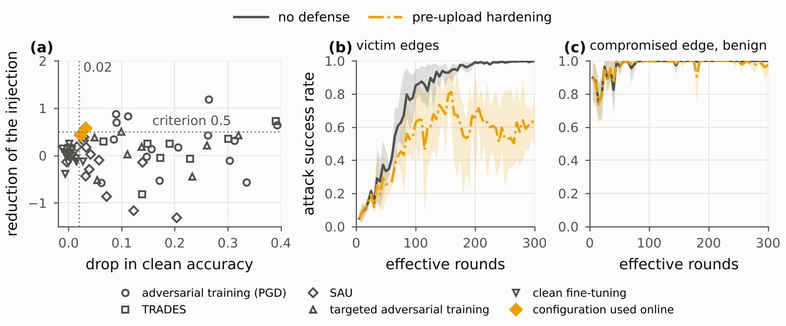

**图 6.4 上传前加固**。(a) 离线筛选：每个点 = 一个配置在一个快照上；横轴 = 干净精度下降，纵轴 = 灌入削减率；形状 = 方法族；橙色实心 = 在线用的配置（削减率 0.58 / 0.44、精度降 0.032 / 0.023）；点线 = 精度门槛 0.02 与判据 0.5 → 左上角（精度降 ≤ 0.02 且削减率 ≥ 0.5）一个点都没有（`accuracy_bound`）。
(b)(c) 在线轨迹（3 种子）：受害边缘、攻击者所在边缘的良性端；灰 = 不设防，琥珀色点划线 = 上传前加固。受害边缘 0.996 → 0.587（均值），攻击者所在边缘 0.999 → 0.982，精度降 0.012。
离线判定由种子 42 决定（单种子）；在线判定预注册、3 个种子。

### 4.4 加固起作用的方式：缩小净增量，而不是砍灌入（F-124，探索性）

受害边缘三台平均、前半程（第 2–30 云轮）每个云周期：

| 种子 | 对照 灌入 / 洗掉 / 净增量 | 加固 灌入 / 洗掉 / 净增量 |
|---|---|---|
| 42 | 0.220 / 0.194 / 0.026 | 0.174 / 0.162 / 0.012 |
| 43 | 0.222 / 0.190 / 0.032 | 0.223 / 0.201 / 0.022 |
| 44 | 0.148 / 0.115 / 0.033 | 0.142 / 0.112 / 0.030 |

后半程（第 31–60 云轮）对照已饱和（灌入 0.010–0.026），加固臂停在不饱和的平衡（灌入 / 洗掉 0.074 / 0.073、0.087 / 0.090、0.087 / 0.091）。
种子 44 的净增量几乎没降，它的降幅也最小（0.228）。离线筛选只量一次灌入，所以预测不了在线结果。按 margin 口径，加固的前半程灌入降约三分之一（2.00 / 2.00 / 1.75 → 1.37 / 1.44 / 1.07，§9）。
这是看过数据之后才算的读数，没有预注册。

---

## 5. CCS 线（已结案，不分层设置）

CCS（Cui et al., ICASSP 2026）= 客户端对抗训练 + 服务端对上传的 BatchNorm 统计量做聚类、剔除离群的上传。
⚠ CCS 官方代码本身跑不起来（F-101），本仓库照的是它的意图；对抗样本照官方在标准化空间里做，约 61% 的像素被截断（F-102）。

### 5.1 一路排查的过程

| 日期 | 实验（组名） | 设置 | 结果 | 结论 |
|---|---|---|---|---|
| 10-29 | CCS 复现闸第一次（CCSF） | FedRep，统计量私有 | 一启动就崩：统计量索引从没注入 | 接线漏洞，测试替生产代码做了这一步（F-107，已修） |
| 10-29 | 同上，修好后整跑 | 同上 | 主任务从第 10 轮停在 0.34，第 54 轮数值溢出崩溃；主机内存要约 31 GiB | 主任务崩坏（F-108、F-109） |
| 10-30 | FedPer + CCS 官方超参数（CCSF 新版、CCSA） | FedPer，统计量共享 | 主任务不崩；但不加防御时良性端只有 0.387 → 判 `invalid_no_attack`（攻击没植入） | FedRep 是主任务崩坏的来源；FedPer 下后门传不到良性端（F-110） |
| 10-30 | FedPer + 我们的训练量（CCSL） | 5 epoch、batch 32 | 良性端仍只有 0.410 | 训练量假设否定（F-111） |
| 10-30 | FedRep，投影网络两段都训（CCSR30） | 照用户的 CCS 复现仓库 | 主任务仍垮（0.29） | 投影网络假设否定；指向私有统计量失配（F-112） |
| 10-31 | FedRep + 统计量共享 + CCS，30 轮（CCSB30） | 只改统计量开关 | 主任务 0.70，不再垮 | **主因确认：客户端私有统计量与新主干失配**（F-113） |
| 10-31 | 统计量共享、不加防御（CCSBOFF） | 300 轮 | 良性端 0.796，主任务 0.894 | 后门能植入（复现条件 1 通过，F-114） |
| 11-01 | 统计量共享 + CCS（CCSB） | 300 轮 | 攻击成功率降 0.684，主任务精度降 0.112 | **部分复现**（F-115） |
| 11-01 | 统计量私有 vs 共享 × 种子 43、44（BNS） | 不加防御 | 差 0.130 / 0.109 / 0.017，平均 0.085 | 「统计量共享削弱后门」**没有确立**（F-116） |
| 11-02 | CCS 拆分（CCSD） | 只开对抗训练 / 只开聚类 | 见 §5.2 | 种子 42：只开聚类就够；精度代价来自对抗训练（F-117） |
| 11-06 | 拆分补种子（CCSOFF5 / CCSDC5 / CCSB3 / CCSDA3） | 种子 43、44（不加防御与只开聚类另补 45、46） | 见 §5.2 | 种子 42 的图景**没有复现**；F-117 两条读法撤回；只开聚类刚过线、2 / 5 失守（F-118、F-119） |
| 11-07 | 只开聚类 + 缓存池（CCSDP） | 种子 43、46（只开聚类失守的两个） | 见 §5.3 | 防御修好、精度超门槛 → `no_fix`；用户事后接受代价（F-120） |

### 5.2 CCS 拆分实验（只开聚类 5 个种子，其余 3 个种子）

| 种子 | 不加防御 | 只开聚类 | 两个都开 | 只开对抗训练 |
|---|---|---|---|---|
| 良性端攻击成功率 42 / 43 / 44 | 0.796 / 0.823 / 0.810 | 0.182 / **0.685** / 0.048 | 0.112 / 0.118 / 0.114 | 0.133 / 0.128 / 0.092 |
| 主任务精度 42 / 43 / 44 | 0.894 / 0.895 / 0.892 | 0.884 / 0.885 / 0.884 | 0.783 / **0.461** / **0.390** | **0.419** / 0.623 / 0.836 |
| 共享模型精度 42 / 43 / 44 | 0.868 / 0.872 / 0.870 | 0.858 / 0.856 / 0.862 | 0.703 / **0.256** / **0.088** | **0.145** / 0.516 / 0.783 |

只开聚类的种子 45 / 46：攻击成功率 0.830 → 0.076 / 0.951 → **0.606**（不加防御 → 只开聚类），主任务精度降 0.016 / 0.012。

- 预注册判定（N-011）：**头条 `cluster_alone_sufficient`**：5 个种子攻击成功率降幅均值 0.523（95% 区间 0.18–0.86），精度降幅均值 0.011（0.008–0.015）。
  只比门槛 0.5 高 0.023，且 5 个种子里 2 个（43、46）各自不满足；按草案里被用户去掉的「至少 4 个种子各自满足」会是 `mixed`（D-124）。
- 归因（种子 42–44）：`cost=adversarial_training; defense=both_components; seed_dependent`（三个种子标签不一致）。
  规则漏洞：只给「只开对抗训练」设了崩坏线，没给「两个都开」设，后者在种子 44 上共享模型精度 0.088，它的防御效果同样被崩坏混淆（照实记录，不事后改规则）。
- **只开聚类**：精度曲线三个种子都平稳；种子 43 上后门第 130 轮穿透共享模型（0.17 → 0.87）。
  漏网时间表（`harness/ccs_leak_timeline.py`）：放进聚合的攻击者上传 27（种子 45）/ 36（44）→ 挡住；67 → 种子 42 挡住、43 失守；77（46）→ 失守。
  → **放进来的越多越容易失守，集中会加速**（描述性读数，5 个点，没有因果证据）。每轮被选中的攻击者数在种子间差不多（284–307），放进来的却差 3 倍 → 随机性来自聚类能不能分出攻击者。
- **对抗训练**：6 个带对抗训练的 run 都从第 65–110 轮起剧烈震荡，有的恢复、有的崩到底；不是聚类造成的（误剔率崩溃前后不变）。原因没有证据（§11 ③）。
- 聚类每轮最多剔 3 个（官方参数），平均每轮约 1 个攻击者被选中、剔中率 77–87% → 每轮固定放过约 1/5。

### 5.3 缓存池探路（种子 43、46，F-120）

| 种子 | 攻击成功率：不加防御 → 只开聚类 → 缓存池 | 降幅（只开聚类 / 缓存池） | 主任务精度降幅（只开聚类 / 缓存池） |
|---|---|---|---|
| 43 | 0.823 → 0.685 → **0.045** | 0.139 / **0.779** | 0.010 / **0.026** |
| 46 | 0.951 → 0.606 → **0.157** | 0.345 / **0.794** | 0.012 / **0.028** |

- 防御：放进聚合的攻击者上传 67 → 25、77 → 50；剔中率 0.78 → 0.92、0.75 → 0.84。
- 代价：池子从 10 个变成约 97 个，每轮剔除 2.7 → 3.8 个（最多 8），良性误剔率 0.21 → 0.32，被剔 ≥ 一半的良性端 12 / 14 → 28 / 33；精度损失是整体的。
  换成只看良性端或不加权，降幅仍是 0.022–0.030；良性端里最差的 10% 降 0.04–0.05。
- 预注册判 `no_fix`（精度两个种子都超 0.02）；用户看过数据后认为可以接受（D-128）。没有在原来挡住的种子 42 / 44 / 45 上跑过。

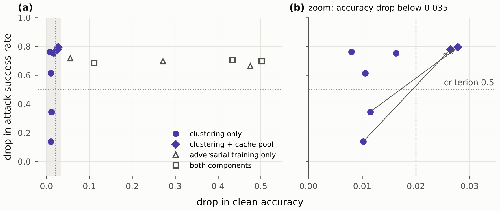

**图 6.5 不分层设置下的统计量聚类**。(a) 全范围：横轴 = 精度下降，纵轴 = 攻击成功率下降，每个点一个种子；紫色实心圆 = 只开聚类（5 种子），紫色菱形 = 聚类 + 缓存池（2 种子），空心三角 / 方块 = 只开对抗训练 / 两个都开；灰底 = (b) 的放大区域。
(b) 精度下降 < 0.035 的部分：箭头 = 缓存池在两个失守种子上的效果；点线 = 判据 0.5 与精度门槛 0.02。只开聚类的点都在精度门槛内，但纵向散得很开（0.139–0.762）；带对抗训练的点精度损失很大。
这一组是**不分层**、旧划分、统计量共享，与主线不可直接比；统计量聚类已有先例，在论文里是对照而不是贡献。

### 5.4 FedPer 下后门传不到良性端

- 后门进了共享模型（0.993–0.997），攻击者自己 1.0，良性端只有 0.39–0.41；FedRep 同一组客户端 0.86–0.93。
- 哪些端被攻破，取决于这个端本来会不会输出目标类（等级相关 0.68–0.71）；本地几乎没有目标类的端几乎免疫。
- 推断（没有直接证据）：FedPer 每一步都把主干和私有部分一起训，私有层学会几乎不输出目标类。统计量共享在 FedRep 上只解释了约 0.085，FedPer 比 FedRep 低约 0.5 → 主因多半不是统计量。
- 外部基准缺失：官方 Bad-PFL 只实现了 FedBN；CCS 官方代码里的 Bad-PFL 训练时不投毒、评估用未训练的生成器；原文「FedPer 下 94%」找不到可运行的出处（F-110）。

### 5.5 降低随机性的候选方法（旧版 §7.1′；用户 2026-11-06 要的分析，F-118 四；只列方案）

| 问题 | 方法 | 现有证据 | 代价 / 需要 |
|---|---|---|---|
| 聚类漏网 | A. 历史 / 信誉规则：过去出现 ≥ 2 次且被剔 ≥ 一半 → 直接剔除 | 反事实回放：放进的攻击者上传 67 → 49、67 → 29、36 → 23（不重新训练） | 多剔约 7% 良性上传，集中在 12–15 个良性端上；小改 `defense/ccs.py` |
| 聚类漏网 | B. 缓存池（`defense.ccs.pool: edge_cache`） | **已做**（§5.3）：修好、代价 0.027 | — |
| 聚类漏网 | C. 上传更新的范数裁剪或阻尼 | 离线筛选里阻尼读数好（F-100） | 要实现；可能拖慢收敛 |
| 对抗训练崩溃 | D. 诊断记录（逐轮训练损失、梯度范数、对抗样本损失） | — | 先确认崩溃触发点 |
| 对抗训练崩溃 | E. 降低对抗训练学习率 / 前若干轮不做再逐步加入 / 缩小扰动预算 | 梯度裁剪已与官方相同（全局范数 10） | 要实现与登记 |

**结案**：用户 11-07 提出「防御要能覆盖其他攻击、方法要体现层级结构」，11-17 选定方向 2（D-129），CCS 线不再交作业；A、C、D、E 都没做。

---

## 6. 方向 2：边缘干净集作参照（已停止）

### 6.1 为什么做、新颖性、一个更正

- **想法**：边缘服务器用自己 500 张干净图算「参照统计量」，逐个给客户端上传打分、过滤可疑上传 —— 取代 CCS「少数服从多数」的聚类（类似 FLTrust 的信任锚），并一开始就与边缘级共享块叠加：
  共享块管跨边缘灌入，参照过滤管边缘内部的攻击者（D-129）。
- **新颖性核查**（F-122，据摘要 + 三篇全文）：没有同时占「三层结构 + 个性化 + 优化型触发器 + 边缘服务器主导防御」四样的工作。最近的先例 **FoggyTrust**（雾节点各持 100 张根数据跑 FLTrust）：
  分层、针对模型投毒（不是后门）、不个性化、用更新余弦、前提是组内同质；**SURA**（干净图 + 统一 BN 参照）单服务器、固定触发器 → 两条直接影响：阈值只在良性开发 run 上标定；威胁模型写明边缘干净集保密。
- **更正**（F-123，代码核对）：旧交接与本报告 11-07 版说「主线统计量私有、根本不上传」，**是错的**。客户端上传 = 完整权重列表，含主干训练段末尾的统计量（对攻击者是投毒批次推动过的）；边缘照样把它们平均进边缘模型。
  客户端保留的私有副本是分类头段末尾、只见干净数据的值 —— SNAP 快照里存的是这个，所以 P0 用快照聚类分不开攻击者（§4.2）。

### 6.2 组内更同质的划分（F-125，D-130）

用户指出「组内应当异质性更低，这是本项目的一个核心假设」。实测（§3.4 的表、图 4.1）：主划分里同边缘两端的差异是跨边缘的 0.79 倍，客户端偏离本边缘平均分布（0.408）比边缘之间的差（0.375）还大。
原因：α_c = 0.5 时均衡的 E0 内部恰好是标准的 Dir(0.5) 非独立同分布设定。于是新写「固定客户端画像」（λ = 0.4 → 比值 0.54）作第二个划分水平，方向 2 的每组实验都在两个划分上各做一遍。
⚠ 攻击者编号由种子决定、画像随之确定（集中布点 s42：画像 0 ×3、1 ×2、2 ×2、4 ×3；画像 0 偏重飞机 + 汽车，飞机 = 目标类）。

### 6.3 第一段：只打分不过滤（组 ERP / ERPB，预注册 N-013，F-126）

- **设计**：ERP = {主划分, 组内更同质} × 边缘级共享块 {关 t0, 开 t1} × 布点 {集中, 分散} × 种子 42，只记录、全部接纳（聚合与不设防同一函数）；
  ERPB = 投毒率 0、攻击者在场的开发 run（种子 41），用来定阈值。
- **候选分数**（都是越大越可疑）：逐客户端参照 KL（上传统计量的高斯与「该上传的权重在干净图上前向算出的矩」之间的 KL；全部层 / stem / 各段）、类混合残差（把上传的统计量拟合成干净图逐类矩的凸组合，残差均方根；新设计）、
  不拟合的残差、缓存池里到其余端的余弦距离中位数。
- **规则**：每个划分内，选「四格（共享块 × 布点）AUROC 取最小、再取最大」的分数；阈值 = 开发 run 里该分数的 90% 分位点；最小 AUROC ≥ 0.75 → `feasible`。
- **有效性**：12 个 run 全部有效；「记录不改训练」的闸通过（主划分不隔离两格与 SNAP 同种子前 60 轮逐位相同：60 个校验和、4560 个已有数值）；打分约 850 s / run。
- **判定**：

| 划分 | 选中的分数 | 四格最小 AUROC | 四格 AUROC（不隔离集中 / 不隔离分散 / 隔离集中 / 隔离分散） | 阈值 τ（不隔离 / 隔离） | 判定 |
|---|---|---|---|---|---|
| 主划分 | 类混合残差 | **0.847** | 0.999 / 0.847 / 0.998 / 0.904 | 0.1190 / 0.1206 | `feasible` |
| 组内更同质 | 逐客户端参照 KL（全部层） | **0.895** | 0.973 / 0.922 / 0.964 / 0.895 | 0.00408 / 0.00373 | `feasible` |

- 描述性读数（单种子）：按 τ 回放，主划分集中布点攻击者几乎全被挡（漏网 0–0.3%），**分散布点漏网 43% / 23%**；良性误剔主划分 5–14%、组内更同质 **17–28%**（名义 10%；没有攻击者的边缘也高 → 是开发种子定的绝对阈值搬到种子 42 不准）。
  零分布（假客户端）在组内更同质划分下不可用（43–48% 高于 τ）。各段 KL 单独看都不稳；缓存池多数原则（CCS 式）四格最小 AUROC 0.65 / 0.70，弱于选中的分数。

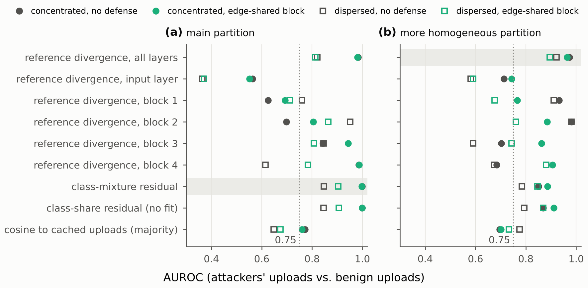

**图 6.6 参照打分的可分性**（只打分、不剔除；种子 42）。(a) 主划分、(b) 组内更同质划分；每行 = 一个候选分数，横轴 = AUROC（攻击者上传 vs 良性上传，全部边缘、全部边缘轮池化）；
实心圆 = 集中布点，空心方 = 分散布点；灰 = 不隔离，绿 = 隔离 1 块；灰底行 = 事先规则选中的分数；点线 = 可行性门槛 0.75。
预注册判定，但每格只有一个种子；只打分阶段的可分性会**高估**在线过滤的效果（§6.6）。

### 6.4 第二段：在线过滤（组 ERF / ERC，预注册 N-014，F-128）

- **设计**：ERF = 同 ERP 的 8 格 × 种子 42–44，分数与阈值沿用第一段（不重选）；分数严格大于 τ 的上传丢弃，本轮全部被丢则边缘模型不变。
  对照：主划分不隔离 = SNAP；其余格子种子 42 = ERP（只记录 = 不设防），43 / 44 = ERC（12 个补跑）。用户确认：分位点 0.90、完整版 36 run、丢弃、门槛照原值（D-132）。
- **标签规则**：三个种子攻击成功率降幅均值 ≥ 0.15、最小种子 ≥ 0.10、精度降幅均值 ≤ 0.02 → `protects`；前两条满足但精度超 → `accuracy_bound`；否则 `no_effect`。
  与共享块组合：过滤 + 隔离 ≤ min(只隔离, 只过滤) − 0.10 → `additive`；差 < 0.05 → `redundant`。
- **有效性**：36 个 run 全部有效，12 个三跑包无显存溢出，配置对账 done 85 / mismatch 0。
- **判定**（降幅 = 不设防对照 − 过滤；判定量是**全部良性端池化**的攻击成功率末 10 点，按边缘拆开见下面第三条）：

| 格子 | 标签 | 降幅 均值 / 最差种子 | 精度降 | 攻击成功率（全部良性端）：对照 → 过滤 | 在线：攻击者放行率 / 良性误剔率 |
|---|---|---|---|---|---|
| 主划分 不隔离 集中 | `accuracy_bound` | 0.420 / 0.337 | 0.0208 | 1.00 → 0.58 | 0.63 / 0.06 |
| 主划分 不隔离 分散 | `accuracy_bound` | 0.379 / 0.298 | 0.0236 | 0.99 → 0.61 | 0.46 / 0.11 |
| 主划分 隔离 集中 | `no_effect` | 0.112 / −0.052 | 0.0135 | 0.40 → 0.29 | 0.64 / 0.05 |
| 主划分 隔离 分散 | **`protects`** | 0.334 / 0.213 | 0.0123 | 0.96 → 0.62 | 0.45 / 0.07 |
| 组内更同质 四格 | `accuracy_bound` ×3、`no_effect` ×1（死锁产物，§6.5） | 0.30–0.86 | **0.45** | → 0.11–0.15 | 0.00 / **1.00** |

  组合：主划分集中 `additive`（过滤 + 隔离 0.286 vs 只隔离 0.399）；主划分分散 `redundant`（0.622 ≈ 只过滤 0.607；只隔离 0.956）。
- 按边缘看（统一对比表，集中布点主划分）：受害边缘 不设防 0.996 → 过滤 0.536、过滤 + 隔离 0.184；攻击者所在边缘良性端 0.999 → 0.781 / 0.800 —— **参照过滤是唯一碰得到攻击者所在边缘的做法**，但幅度有限、精度代价贴着门槛。

### 6.5 冷启动死锁（组内更同质划分；不是干净集的问题）

12 个组内更同质的过滤 run，1200 个边缘轮**全部** 100% 被丢：第 1 轮逐客户端参照 KL 中位数 0.0087 > τ 0.0041 → 全部丢弃 → 模型停在初始值 → 下一轮分数照样约 0.0085 → 300 轮一次都没更新
（攻击成功率 0.11–0.15 = 底线，精度 0.39 = 只有私有分类头在学）。用户问「是不是干净集选得有偏差」—— **不是**。开发 run（不投毒、只打分）里两个分数在各训练阶段的中位数：

| 分数 | 划分 | 第 1 轮 | 2–5 | 6–30 | 31–100 | 101–300 | 第 1 轮 ÷ 后期 |
|---|---|---|---|---|---|---|---|
| 逐客户端参照 KL | 主划分 | 0.0094 | 0.0053 | 0.0039 | 0.0035 | 0.0038 | 2.48 |
| 逐客户端参照 KL | 组内更同质 | 0.0087 | 0.0053 | 0.0039 | 0.0033 | 0.0035 | 2.45 |
| 类混合残差 | 主划分 | 0.1238 | 0.0944 | 0.0927 | 0.0993 | 0.1096 | 1.13 |
| 类混合残差 | 组内更同质 | 0.1201 | 0.0964 | 0.0924 | 0.1002 | 0.1094 | 1.10 |

同一分数在两个划分下走势几乎相同；第一段恰好给组内更同质划分选了「训练初期是后期 2.5 倍」的 KL、给主划分选了基本持平的类混合残差。
→ 死锁 = **分数选择 + 全程固定阈值 + 「全被丢则模型不变」** 三者叠加；主划分若选 KL 同样会死锁。KL 早期偏高的原因没有证据。
规则漏洞（照实记，不改标签）：N-014 没有「模型从未训练」的闸；Claude 在第一段只按全程算了误剔，没查第 1 轮分数与 τ 的关系（开发 run 第 1 轮 100% 超 τ，本可提前看到）。
主划分也有局部同类现象：0–44 个边缘轮全部被丢；良性误剔随训练变大（第 151–300 轮 0.04–0.23）。

### 6.6 反馈循环：参照分数滞后于后门（F-129 + 离线探针 P-c，F-136）

- **在线读数**（种子 42、主划分集中、只比 E0 内部；单种子、相关性）：过滤改变了攻击者的分数 ——

| | 攻击者类混合残差中位数 | E0 良性端中位数 | 「上一云轮 E0 良性攻击成功率」与「本轮攻击者分数」的相关 |
|---|---|---|---|
| 不隔离 · 只打分 | 0.205 | 0.101 | 0.07（E0 一直饱和在约 1.0） |
| 不隔离 · 过滤 | **0.095** | 0.096 | **0.57** |
| 隔离 · 只打分 | 0.218 | 0.107 | 0.20 |
| 隔离 · 过滤 | **0.106** | 0.098 | **0.71** |

  同格内放行率与攻击成功率**负相关**（放行 0.86 / 0.36 / 0.67，攻击成功率 0.49 / 0.59 / 0.66）—— 放行率高不等于后门强。
- **解释**：Bad-PFL 的触发器是有界小扰动。模型没学会后门时，加触发器的图片在模型眼里与普通图片差不多 → 统计量几乎不偏 → 分数低；学会后门后同一触发器引起强烈内部响应 → 统计量偏移 → 分数高。
  于是：过滤压住后门 → 攻击者看起来正常 → 放行 → 后门回升 → 分数升高 → 被拦 → 平衡在攻击成功率约 0.3–0.6。推论：只打分时测到的区分能力**高估**在线效果。
- **离线直接证据**（P-c，预注册 N-015 第五节）：108 个边缘模型（SNAP 集中 + 分散 + TBS k1-snap × 第 6 / 15 / 60 轮 × 4 台边缘）上，「同一批干净图加触发器前后各 BN 层输入矩的 KL」与「该边缘良性端触发 margin」的
  合并 Spearman **0.911**；每个种子 0.901 / 0.933 / 0.903；每轮内部 0.780 / 0.890 / 0.882；按轮分层置换 p = 0.0001 → 不是「两者都随训练轮次变大」造成的；去掉目标类图片后 0.908 → 判 **`feedback_moderate`**（反馈循环从「弱」升为「中」）。
  局限：仍是相关性；偏移测在裸边缘模型的训练模式前向上，后门强度测在各客户端的评估用模型上；同一 run 的 4 台边缘共用一个生成器。

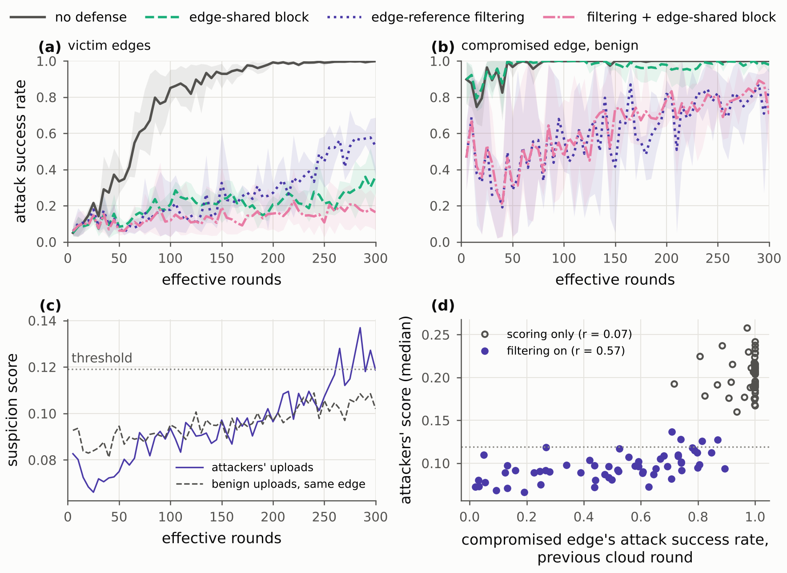

**图 6.7 在线过滤与反馈循环**。(a)(b) 受害边缘 / 攻击者所在边缘良性端的轨迹（3 种子），四种设置：不设防、共享块、参照过滤、过滤 + 共享块；受害边缘终值 0.996 / 0.281 / 0.536 / 0.184，攻击者所在边缘 约 1.0 / 约 1.0 / 0.781 / 0.800。
(c) 种子 42、过滤开：攻击者所在边缘里攻击者上传（紫实线）与良性上传（灰虚线）的分数中位数随云轮，点线 = 阈值 0.119 —— 过滤开后攻击者分数降到和良性端一样。
(d) 横轴 = 上一云轮攻击者所在边缘的攻击成功率，纵轴 = 本云轮攻击者分数中位数；空心 = 只打分（r = 0.07），实心紫 = 过滤开（r = 0.57）。(a)(b) 的标签是预注册判定；(c)(d) 是单种子的相关性读数。

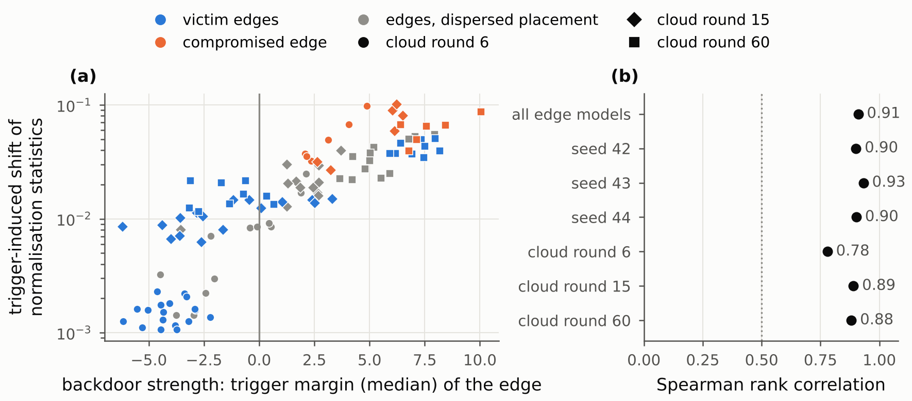

**图 6.7b 统计量偏移随后门强度**。(a) 108 个边缘模型：横轴 = 该边缘良性端触发 margin 中位数（后门强度），纵轴 = 边缘 500 张干净图加触发器前后各 BN 层输入矩的高斯 KL 的层均值（对数）；
颜色 = 边缘角色（蓝 受害边缘、橙 攻击者所在边缘、浅灰 分散布点的边缘），实心形状 = 训练轮（圆 6、菱形 15、方 60）。(b) 预注册写定的 Spearman：全部、每个种子、每轮内部；点线 = 0.5 门槛。
探索性（看过数据之后才算，图上没画）：只看受害边缘 0.845、只看分散布点 0.900 → 相关不只是「攻击者边缘 vs 受害边缘」撑起来的。

### 6.7 误判落在谁身上（描述性，3 种子合并）

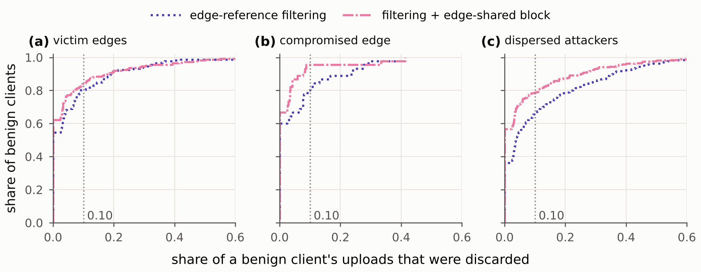

**图 6.8 良性端的误判分布**（只做主划分；组内更同质划分全部被丢，不提供信息）。三个面板 = 集中布点的受害边缘 / 集中布点的攻击者所在边缘 / 分散布点；横轴 = 一个良性端被丢弃的上传比例，纵轴 = 良性端的累计比例；
紫点线 = 参照过滤，粉点划线 = 过滤 + 共享块；点线 = 名义误剔率 0.10。
从未被丢弃的良性端（过滤 / 过滤 + 共享块）：受害边缘 55% / 62%、攻击者所在边缘 60% / 67%、分散布点 36% / 57%；单个良性端被丢弃的最高比例：受害边缘 0.70 / 0.77、攻击者所在边缘 0.38 / 0.41、分散布点 0.79 / 0.86。
→ 多数良性端很少被丢，少数被丢一半以上；分散布点下误判更多。被误判的客户端有什么共同特征（例如数据分布少见）**没有分析**。

### 6.8 小结与停止（D-134）

只打分时分得开（`feasible`），但在线过滤只能削弱后门（约 0.5–0.6），只有「共享块开 + 分散布点」一格过全部门槛；组内更同质划分的结果是冷启动死锁、不作证据；
分数测的是「模型已被植入后门」而不是「这个客户端正在投毒」（反馈循环，中等强度证据）。**方向 2 不再交作业**（11-19）；之后转入论文整合与补充实验（§7–§9）。

---

## 7. 边缘级共享块（三层个性化）：主结论与补充实验

做法：ResNet-10 的最后 B 个残差块（含 shortcut 与 BN 统计量）是「边缘段」—— 边缘内照常聚合，**不上云**：云聚合把它换回聚合前的值（全局模型里那一段永远是初值），云广播不覆盖它。
客户端与评估用模型都不用改（边缘模型自带本边缘的边缘段）。论文里叫 edge-shared blocks；内部配置键 `federation.edge_shared_blocks`。

### 7.1 效果（集中布点）

- 阶段二在旧划分上有预注册判定：隔离 1 / 2 块把受害边缘降 0.52 / 0.73，精度代价 ≤ 0.02 → `blocks`（F-077）；分散布点无效（F-069）。
- 阶段三在两种新划分上各 3 个种子（不设防对照：SNAP、ERP / ERC 的只记录格；隔离 1 块：ERP / ERC 的 t1 格，只记录模式已证与不设防逐位相同）：

| 划分 | 受害边缘 不设防 → 隔离 1 块 | 攻击者所在边缘良性端 | 精度降 |
|---|---|---|---|
| 主划分 | 0.996 → **0.281** | 0.999 → 0.988 | 0.002 |
| 组内更同质 | 0.911 → **0.302** | 1.000 → 1.000 | −0.001 |
| 分散布点（主划分，全部良性端） | 0.986 → 0.956 | — | 0.002 |

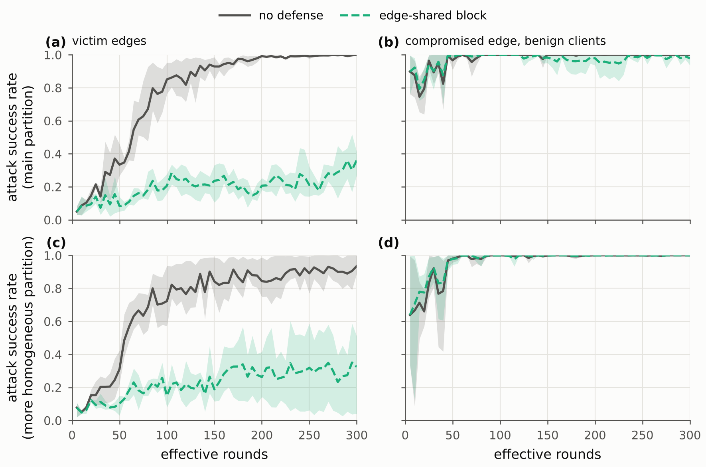

**图 6.1 边缘级共享块（集中布点）**。2 × 2：行 = 主划分 / 组内更同质划分，列 = 受害边缘 / 攻击者所在边缘的良性端；灰实线 = 不设防，绿虚线 = 隔离最后 1 块；浅色带 = 3 个种子的范围。
受害边缘被压到约 0.3，两种划分一致；攻击者所在边缘的良性端完全不受保护。主划分曲线最后阶段有回升（约 0.35），不能说「已压到底」。

### 7.2 结构核查：三层个性化真的按设计在工作（D0，F-133）

- D0a：CPU 小联邦真跑一个云轮（k ∈ {1, 2, 4}），上云段云聚合正确、边缘段不上云不被覆盖、私有部分逐客户端不同。
- D0b：TBS k1-snap 三个种子 × 第 6 / 15 / 60 轮快照：全局上云段 = 四台边缘上云段的加权平均（拟合权重 0.25 × 4、相对残差 3.7–3.9e-8、拟合矩阵满秩）；
  四台边缘的上云段两两不同（排除「快照其实存在广播之后」的退化情况）；全局边缘段三个快照完全相同且与每台边缘都不同（从未上云）；客户端私有部分两两不同。
- 第一次核查（`6627ae8`）有两个盲点（四台边缘上云段完全相同也会通过；拟合只用了前 40 万个坐标），补强后重跑（`9eb772f`，D-137）仍全过。→ 结构前提成立。

### 7.3 代价对照：是不是「只是少共享」（块数扫描，组 TBS，预注册 N-015 D1，F-130）

集中布点 × 隔离块数 B ∈ {1（存快照）, 2, 4} × 种子 42–44；B = 0 = SNAP。判定量 D = 主任务精度(B=1) − 主任务精度(B=4)；三个种子都 D ≥ 0.02 → `b1_meaningful`，都 |D| < 0.01 → `isolation_free`。

| 种子 | 精度(B=1) | 精度(B=4) | D |
|---|---|---|---|
| 42 | 0.8642 | 0.8441 | 0.0202 |
| 43 | 0.8745 | 0.8521 | 0.0223 |
| 44 | 0.8612 | 0.8431 | **0.0182** |

→ 种子 44 落在 0.01 与 0.02 之间 → **`inconclusive`，报数字不报方向**（用户 11-23 选择不补种子，D-136）。论文写法：「隔离 1 块相对几乎完全隔离多保住的精度在三个种子上是 0.018–0.022」。
有效性闸通过：TBS k1-snap 与 ERP / ERC 隔离 1 块集中格三个种子各 60 个校验和 + 4560 个数值逐位相同（也是「k = 1 下只记录不改训练」的第一条直接证据）。

| 块数 B | 上云参数比例 | 受害边缘 | 攻击者所在边缘良性端 | 主任务精度 | 相对不设防的精度代价 |
|---|---|---|---|---|---|
| 0（不设防） | 100% | 0.996 | 0.999 | 0.868 | — |
| 1 | 25.1% | 0.281 | 0.988 | 0.867 | 0.002 |
| 2 | 6.4% | 0.046 | 0.987 | 0.859 | 0.010 |
| 4 | 0.14% | 0.027 | 1.000 | 0.846 | 0.022 |

受害边缘三个种子都单调（B=4 ≤ B=2 ≤ B=1）；B = 2 / 4 的每周期灌入约为 0。按类精度没有记录 → 个性化评估只测本地分布，可能低估共享的价值。

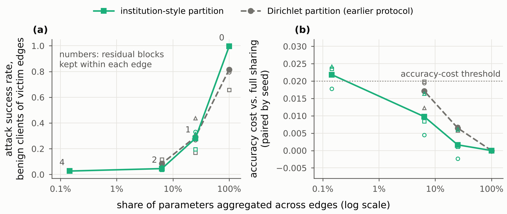

**图 6.2 共享深度的权衡**。横轴 = 跨边缘聚合的参数比例（对数刻度）；(a) 受害边缘攻击成功率（点旁数字 = 留在边缘内的残差块数），(b) 相对完全共享的精度代价（按种子配对），点线 = 0.02 门槛。
绿实线 = 主划分（隔离 0 / 1 / 2 / 4 块），灰虚线 = 阶段二旧划分（0 / 1 / 2 块，复现序列）；空心标记 = 单个种子。上云的参数越少受害边缘越安全；只隔离最后一块就压到 0.28、精度几乎不变；隔离更多块压得更低，但精度代价逐步上升。

### 7.4 威胁边界：边缘里有 1 个攻击者（组 TBH，预注册 N-015 D2，F-131）

布点 [9,1,0,0]（E0 9 个攻击者、E1 1 个、E2 / E3 干净）× B ∈ {0, 1} × 种子 42–44。

| 种子 | 干净边缘 E2 / E3（B=0） | E2 / E3（B=1） | 干净边缘降幅 | E1 良性端（B=1） | E1 与干净边缘之差 |
|---|---|---|---|---|---|
| 42 | 0.944 / 0.996 | 0.264 / 0.310 | 0.683 | 0.931 | 0.644 |
| 43 | 0.886 / 0.959 | 0.248 / 0.300 | 0.649 | 0.999 | 0.725 |
| 44 | 0.975 / 0.992 | 0.246 / 0.504 | 0.608 | 0.941 | 0.566 |

- 两个判定都过：干净边缘降幅三个种子都 ≥ 0.30 → **`clean_protected`**；差三个种子都 ≥ 0.20 → **`e1_breached`**。
- 含义：最后一块只被良性端训练的边缘受保护；最后一块有攻击者参与训练的边缘失守，而且 25 个客户端里**只要 1 个**攻击者（参与频率约 10%）就够。
  「信任域」解释由此从「和数据一致」升为「事先预测、被检验」；有效条件 = 攻击者只在部分边缘。精度 B=0 0.867、B=1 0.868。

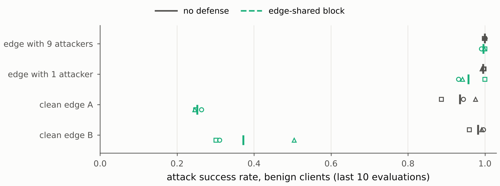

**图 6.3 威胁边界**。行 = [9,1,0,0] 下的四台边缘（9 个攻击者、1 个攻击者、两台干净边缘）；横轴 = 良性端攻击成功率；灰 = 不设防，绿 = 隔离 1 块；空心 = 种子，竖短线 = 均值。
干净边缘 0.89–1.00 → 0.25–0.50；有 1 个攻击者的边缘在隔离下仍 0.93–1.00。

### 7.5 机制：后门没传过来（离线探针 P-b，F-135）

TBS k1-snap 第 60 轮，受害边缘良性端（种子 42 / 43 / 44）：

| 触发器怎么构造 | 攻击成功率 |
|---|---|
| 评估触发器（ξ 在攻击者模型上求 + 生成器扰动；= 正文主列） | 0.401 / 0.272 / 0.410 |
| 白盒触发器（ξ 在受害者自己的新鲜个性化模型上求） | 0.329 / 0.261 / 0.342 |
| 白盒 − 评估 | **−0.072 / −0.011 / −0.068** |
| 只用生成器扰动 δ | 0.243 / 0.218 / 0.207 |
| 只用 ξ（受害者模型 / 攻击者模型） | 0.122 / 0.107 / 0.170；0.114 / 0.086 / 0.160 |
| 不加触发器 | 0.016 / 0.015 / 0.024 |

- 三个种子 |差| 都 < 0.10 → **`not_transmitted`**：在受害者自己的模型上求扰动并不能找出「主列测不到的后门」→ 受害边缘剩下的约 0.3–0.4 就是传过去的那部分后门的全部；
  「后门其实在、只是触发器迁移不过去」被排除，支持 6.1「最后一块不上云截住了跨边缘传播」。
- 不设防参照（SNAP 集中）：两列都约 1.0（差 ≤ 0.003），只用 δ 就到 0.998–1.000；分层隔离下只用 δ 只有 0.21–0.24。
- 局限：只测第 60 轮、集中布点；白盒 ξ 是与评估同预算的单步 PGD，更强的白盒搜索可能找到更多。重现闸 27 / 27 全过（离线重算主列与记录最大差 0.0005）。

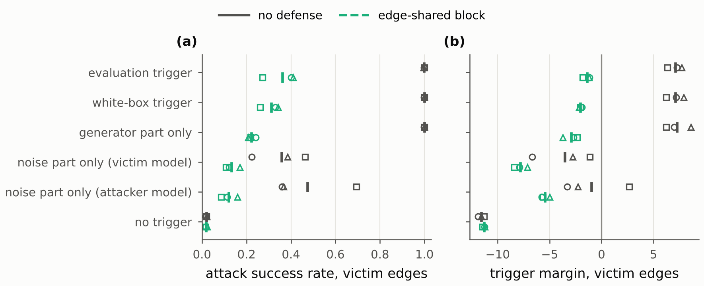

**图 6.1b 受害边缘的残余从哪来**（第 60 云轮、集中布点）。行 = 六种触发器构造；(a) 受害边缘攻击成功率（三台均值），(b) 触发 margin；灰 = 不设防、绿 = 隔离 1 块；空心 = 种子，竖短线 = 均值。
每个受害客户端的两列用同一批图、同一个随机起点、同一个生成器扰动（配对比较）。

### 7.6 「后门主要存在最后一块」未能验证（离线探针 P-a + 追加，F-134 / F-137）

- **第一次（P-a，N-015）**：在 E0 的上传前模型上用 500 张干净图重训，只训最后一块 / 只训前面几层 / 训全部主干，三臂 6 个清除比例（3 种子 × 第 15 / 60 轮）**全是 0.000** → 规则判 `mainly_earlier_layers`，
  但**阳性对照（训全部主干）也是 0** → 没有分辨力，不能照字面读。原因：沿用 P0 的预算（学习率 = 客户端 × 0.1，第 15 轮 0.0055、第 60 轮 0.0009；75 步），权重几乎没动（最大改变量 0.0003–0.014）。
  预注册没写「对照也失败时怎么读」—— 设计漏洞。
- **追加探针**（N-016，看过第一次结果之后设计、写于数据之前）：先在种子 42 上只训全部主干、扫 12 档找「两轮都清除 ≥ 0.5 且精度降 ≤ 0.05」的最小一档：

| 档 | 清除比例（第 15 / 60 轮） | 精度降幅 | 权重最大改变量 |
|---|---|---|---|
| 学习率 0.01 / 0.03 的 8 档（75 或 300 步、两种头） | 0.000–0.013 | −0.010 … 0.035 | 0.009–0.046 |
| 0.1 · 75 步 · 临时线性头 | **0.992 / 0.728** | **0.426 / 0.248** | 0.146 / 0.094 |
| 0.1 · 300 步 · 临时线性头 | **0.696 / 0.808** | **0.328 / 0.182** | 0.257 / 0.210 |
| 0.1 · 75 步 · 重新初始化头 | 0.025 / 0.034 | 0.074 / 0.056 | 0.050 / 0.048 |
| 0.1 · 300 步 · 重新初始化头 | 0.175 / 0.050 | 0.096 / 0.058 | 0.081 / 0.077 |

  → 没有合格的一档 → **`not_removable`**，按规则不交正式作业。后门只在模型被打坏时才消失（E0 良性端干净精度第 15 轮 0.843 → 0.418）。
- **含义**：P-a 定位不了后门存在哪一层；论文写「后门存在最后一块」这一前提**未验证**，6.1 的机制只剩 P-b 的「隔离传播」直接证据。
  ⚠ 精度崩可能部分来自「新主干 + 没重训的私有分类头」对不上 → **不能**读成「后门与主任务缠在一起」。
- 附带读数（探索性）：快照里的私有 BN 统计量是陈旧的，只精确重估就让 E0 良性端干净精度第 15 轮升 0.075–0.14（§3.7 的注意事项）。

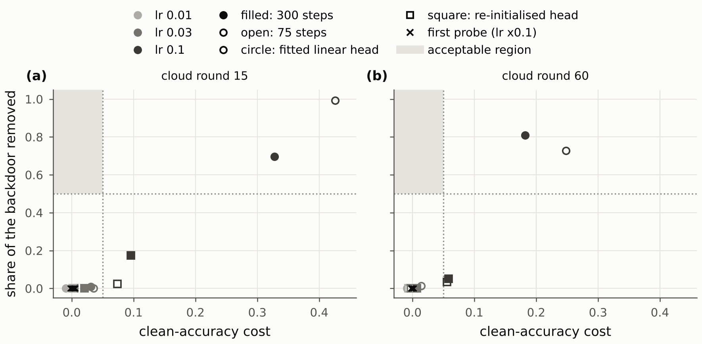

**图 A.1 重训探针**。(a) 第 15 云轮、(b) 第 60 云轮；横轴 = E0 良性端的干净精度代价（相对「不重训、只重估统计量」的基线），纵轴 = 后门清除比例（清到底线 = 1）；
灰阶 = 学习率（0.01 / 0.03 / 0.1），实心 = 300 步、空心 = 75 步，圆 = 临时线性头、方 = 重新初始化的头（追加探针，种子 42）；× = 第一次探针（三臂 × 3 种子）；浅灰阴影 = 可接受区（清除 ≥ 0.5 且代价 ≤ 0.05）—— 一个点都没有。

### 7.7 待议：云端共享的价值在本设定下偏小（未决，只记录）

块数扫描显示：几乎断开云端共享（B = 4）也只差约 0.02 精度，同时云端共享正是后门跨边缘传播的通道（0.027 → 0.996）。用户 11-23 问「三层结构本身的存在价值是什么」，记在 `experiments/thesis/ISSUE-sharing-value.md`：
- 推测的原因（都没有数据）：评估只看本地分布；每台边缘约 9400 张训练图、任务简单；机构结构偏弱（边缘之间总变差只有 0.375）。
- 可选方案（都未排期，要做先写预注册）：A 数据稀缺（每端 100 张 × B ∈ {0, 1, 4}，约 10 GPU 小时）；B 块内切分（上云约 52% / 73%，需改 `tier_split`；P-a 没给出依据）；C 跨边缘评估（免训练）；D 只写进论文。
- 论文措辞底线：不说「B = 1 恰好是最优点」，只说「B = 1 几乎不花精度就压掉约 72% 的跨边缘后门」。

---

## 8. 已知防御基线：逐坐标中位数

组 MED（预注册 N-015 D4，F-132）：{边缘层（每台边缘 2–3 个上传取中位数）, 云层（4 个边缘模型取中位数）} × {集中, 分散} × 种子 42–44，不隔离。

| 臂 | 布点 | 判定量 | 降幅（逐种子） | 精度降均值 | 标签 | 与隔离 1 块比 |
|---|---|---|---|---|---|---|
| 边缘层中位数 | 集中 | 受害边缘 | 0.004 / 0.050 / 0.004 | 0.002 | `blocks` | `weaker_than_b1`（高 0.66–0.75） |
| 边缘层中位数 | 分散 | 全部良性端 | 0.025 / 0.043 / 0.038 | 0.001 | `blocks` | `comparable_to_b1` |
| 云层中位数 | 集中 | 受害边缘 | 0.047 / 0.105 / 0.030 | 0.001 | `blocks` | `weaker_than_b1`（高 0.62–0.70） |
| 云层中位数 | 分散 | 全部良性端 | 0.007 / −0.001 / −0.022 | 0.000 | `not_blocks` | `comparable_to_b1` |

- 规则里的 `blocks` 只要求方向（三个种子都 > 0）+ 精度代价 ≤ 0.02 → **正文必须带效应量**：受害边缘终值仍在 0.89–0.99（不设防 0.996）；集中布点比隔离 1 块高 0.6 以上。
  分散布点的「comparable_to_b1」只说明两者都几乎无效。
- 与事先写下的预期（不是规则）对照：云层中位数预期「集中布点能压低、精度代价可能 > 0.02」→ 两条都没应验；边缘层中位数集中无效、分散小幅作用 → 应验。
- 机制读数（描述性）：两个中位数臂每个云周期的灌入 0.16–0.24（不设防 0.15–0.22）→ **中位数不砍灌入**。云层中位数集中布点时只有 E0 一个模型被污染，4 个模型取中间两个的平均却仍把后门灌进来 ——
  被灌入的不是「一个离群边缘模型」的极端坐标，而是在多数坐标上与良性边缘混在一起的方向（解释未直接验证）。图见 §9 图 6.9 的两行灰色。

---

## 9. 综合比较与灌入—洗掉分解

**描述性汇总，不是判定**；各臂的正式标签以各自的判定文件为准。数据：`experiments/thesis/analysis/defense_balance.{json,md}`（`harness/defense_balance.py`，纯标准库，测试钉住）。降幅 = 同划分、同布点、同种子的不设防对照 − 本臂。

**主划分、集中布点：终值（3 种子均值）**

| 臂 | 受害边缘 | 攻击者所在边缘良性端 | 全部良性端 | 主任务精度 | 受害边缘降幅 | 精度降 |
|---|---|---|---|---|---|---|
| 不设防 | 0.996 | 0.999 | 0.997 | 0.868 | — | — |
| 共享块（隔离 1 块） | 0.281 | 0.988 | 0.399 | 0.867 | 0.715 | 0.0016 |
| 共享块（隔离 2 块） | 0.046 | 0.987 | 0.203 | 0.859 | 0.950 | 0.0098 |
| 共享块（隔离 4 块） | 0.027 | 1.000 | 0.189 | 0.846 | 0.969 | 0.0218 |
| 上传前加固 | 0.587 | 0.983 | 0.653 | 0.856 | 0.409 | 0.0119 |
| 参照过滤 | 0.536 | 0.781 | 0.577 | 0.847 | 0.460 | 0.0209 |
| 参照过滤 + 共享块 | 0.184 | 0.800 | 0.286 | 0.853 | 0.812 | 0.0152 |
| 边缘层中位数 | 0.976 | 1.000 | 0.980 | 0.867 | 0.019 | 0.0017 |
| 云层中位数 | 0.935 | 0.998 | 0.946 | 0.867 | 0.061 | 0.0009 |

**主划分、分散布点：全部良性端**：不设防 0.986；共享块 0.956；上传前加固 0.713（单种子，精度降 0.030）；参照过滤 0.607（精度降 0.024）；过滤 + 共享块 0.622（0.015）；边缘层中位数 0.950；云层中位数 0.991。

**主划分、集中布点：受害边缘每个云周期（前半程第 2–30 云轮，逐种子）**

| 臂 | 灌入 | 洗掉 | 净增量 | 灌入（margin 口径） |
|---|---|---|---|---|
| 不设防 | 0.220 / 0.222 / 0.148 | 0.194 / 0.190 / 0.115 | 0.026 / 0.032 / 0.033 | 2.00 / 2.00 / 1.75 |
| 共享块（隔离 1 块） | 0.035 / 0.072 / 0.071 | 0.034 / 0.064 / 0.061 | 0.001 / 0.008 / 0.010 | 0.94 / 1.20 / 1.01 |
| 上传前加固 | 0.174 / 0.223 / 0.142 | 0.162 / 0.201 / 0.112 | 0.012 / 0.022 / 0.030 | 1.37 / 1.44 / 1.07 |
| 参照过滤 | 0.059 / 0.224 / 0.073 | 0.056 / 0.205 / 0.068 | 0.003 / 0.020 / 0.005 | 1.25 / 2.39 / 1.46 |
| 参照过滤 + 共享块 | 0.007 / 0.091 / 0.008 | 0.008 / 0.077 / 0.007 | −0.001 / 0.013 / 0.002 | 0.41 / 1.35 / 0.52 |
| 边缘层中位数 | 0.216 / 0.229 / 0.161 | 0.189 / 0.200 / 0.129 | 0.027 / 0.029 / 0.033 | 1.94 / 1.96 / 1.71 |
| 云层中位数 | 0.184 / 0.241 / 0.158 | 0.167 / 0.213 / 0.127 | 0.018 / 0.028 / 0.030 | 1.87 / 2.09 / 1.70 |

读法：共享块主要靠**减少灌入**（攻击成功率口径砍到 1/3–1/6，margin 口径约一半）；上传前加固按攻击成功率看几乎不减少灌入、按 margin 看减少约三分之一，主要作用在净增量上（**两个口径不一致，正文要明说**）；
参照过滤前半程能减少灌入，后半程回升（0.15–0.20）；中位数不砍灌入。组内更同质划分的过滤臂是死锁产物，表里不列（见 `defense_balance.md`）。

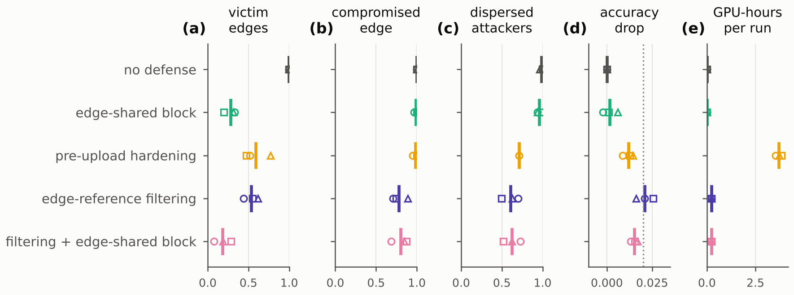

**图 6.9 综合比较**（主划分）。五列 = 受害边缘、攻击者所在边缘（集中布点）、分散布点的全部良性端（三列都是攻击成功率）、精度下降、每个实验的防御计算量（GPU 小时）；行 = 七种设置；空心 = 种子，竖短线 = 均值；精度列点线 = 0.02。
计算量 = 防御自身的计算时间（加固约 3.7、参照打分约 0.24 GPU 小时 / 实验），不是整个实验的时长；中位数没有单独计时，画在 0。分散布点的加固只有种子 42。
一句话：共享块在集中布点下效果最好、几乎零代价；过滤与共享块叠加最低；只有参照过滤碰得到攻击者所在边缘；中位数几乎无效；加固最贵。

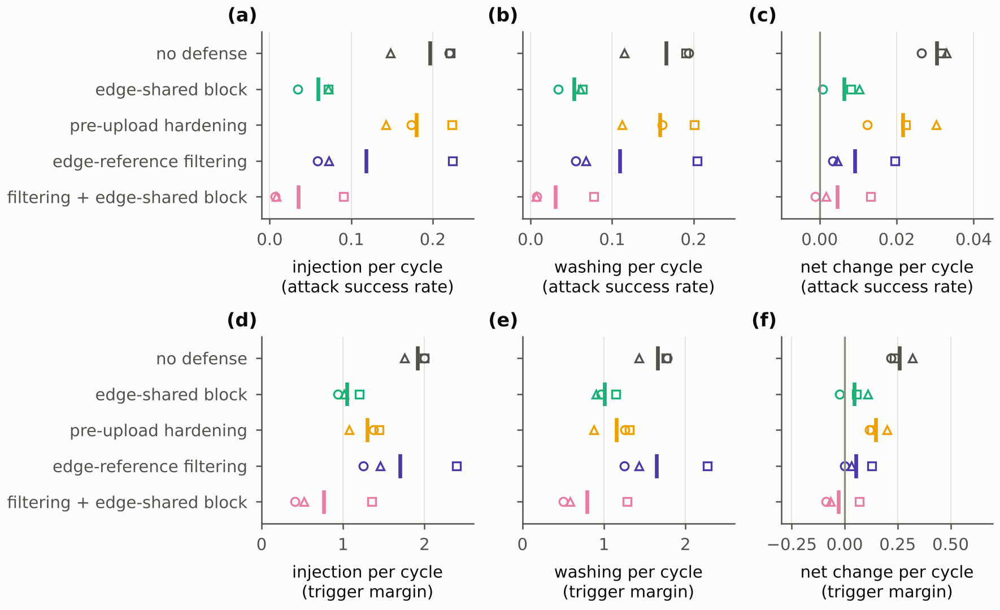

**图 6.10 灌入—洗掉按防御分解**（受害边缘、集中布点、前半程）。上行 = 攻击成功率口径，下行 = margin 口径；三列 = 每周期灌入、洗掉、净增量；行 = 五种设置；空心 = 种子，竖短线 = 均值。
描述性分析，部分数据在写分析规则前已经看过，不称为预注册。

---

## 10. 攻击基线（进行中）

### 10.1 要回答的两个问题（PREREG-v2 第七节，预注册 N-015，D-135）

- **问题一（刻画）**：比 Bad-PFL 弱的攻击，在三层分层 + FedRep 下能不能植入、能不能跨边缘传播？回答「为什么必须研究 Bad-PFL」，并在分层设定下复核「弱攻击在个性化联邦学习里难以存活」的文献结论。
- **问题二（泛化）**：对能传播的攻击，边缘级共享块（B = 1）与上传前加固是否仍然有效？
- 六种基线攻击（2026-11-20 定）：BadNets、Blended、DBA、Neurotoxin、CerP、IBA。

### 10.2 第一档：静态三种攻击接到主实验取数路径（D-141，F-138）

- **为什么要接线**：主实验协议每轮从原始数组按索引重新取数，不读旧 `vanilla` 策略在开跑前替换进去的投毒数据集 → 恶意端会**静默变成良性端**（`config_validate` 因此一直拒绝这种组合）。
- 新策略 **`static`**（`fedavg/client/client_static.py`，纯算术 `fedavg/attack/static_poison.py`）：在每个批上投毒；用户拍板四处（都选推荐项）：
  ① 每批按 `backdoor.poison_sampling` 抽（主实验 = 每张独立 0.2，与 Bad-PFL 同一个开关、同一个函数）；② 先增强、再加触发器；③ 与 Bad-PFL 一样强制串行；④ 新起策略名，旧 `vanilla` 只配旧取数路径。
- **触发器参数**：BadNets = 右下角 3×3 白块（像素值 1.0）；Blended = hello_kitty 图以 α = 0.2 混合（训练与评估同一个 α）；DBA = 官方 4 块局部触发器，每块 1×6 像素（第 0 / 4 行 × 第 0–5 / 9–14 列），
  10 个攻击者轮流分到 3 / 3 / 2 / 2，评估用 4 块合起来的 24 像素全局触发器。
- **与官方的已知偏离**（写进论文方法与局限）：投毒率 0.2、10 个攻击者、全程投毒、目标类 0、学习率与本地轮数、先增强后加触发器 —— 全部同 Bad-PFL 对照，几种攻击之间只差触发器；
  **不做 DBA 的「更新放大 100 倍」**（那是另一种攻击成分 = 模型替换，在 FedRep + 边缘内每轮 2–3 个参与者的平均下会直接把边缘模型炸掉，Bad-PFL 对照也没有它）。
- **评估**：静态触发器没有「固定评估攻击者」→ 服务器退回静态触发器（全量点、轻评估点、云聚合后评估点三处，测试钉住）；冻结触发器列关掉（静态触发器不漂移）。
  自描述 `[设定15]`（攻击策略、触发器、DBA 块数、抽样方式）+ 每次本地训练一行 `[Poison]`（被投毒张数 / 经过钩子的张数）。
- **证据**：本地 Python 3.11 不装 TF 2379 passed / 63 skipped / 3 xfailed；装 tensorflow-cpu 2.15.1 全量 2713 passed / 2 failed（陷阱 #4 的已知 2 条，无回归）；
  TF 新测试 11 条全过（含 `main.build_clients` 真接线 + 两个反向锚点）。**GPU 上的确定性与显存没有证据**，等 ATKP。

### 10.3 登记与分流规则

- **ATKP（探路）**：badnet / badnet 重复 / blended / dba × 种子 42 × **4 云轮**（20 有效轮）；badnet 与它的重复同配置，验 GPU 上两次逐位相同。配置已生成、可交。
- **ATK（正式第一阶段）**：三种攻击 × 种子 42 × 不设防 × 集中布点 × 主划分 × 300 有效轮；挂 `atkp-ok`（ATKP 过放行检查后才放行）。与 SNAP 集中格只差攻击设置（守卫 `tests/test_static_poison.py`）。
- **分流**（`harness/atk_route.py`，写于数据之前；看末 10 个评估点的原始攻击成功率；这是路由决定，不是论文结论）：

  | 分支 | 规则 | 去向 |
  |---|---|---|
  | 能传播 `propagates` | 受害边缘良性端 ≥ 0.30 | 进第二阶段：{不设防, B=1, 上传前加固} × 集中 × 3 种子，判定同 D-071 |
  | 只在本地 `local_only` | 攻击者所在边缘良性端 ≥ 0.30、受害边缘 < 0.30 | 补种子 43、44（不设防），作问题一的证据 |
  | 没植入 `no_implant` | 攻击者所在边缘良性端 < 0.30 | 同上 |

  三个种子落在同一分支才写成结论。静态触发器没有 Bad-PFL 那种「投毒率 0 的影子攻击者」底线 → 原始攻击成功率旁附「干净样本被判成目标类的比例」作参照。

### 10.4 后续几档（时间盒 2026-12-06，到期没接通的写进论文局限）

- ② **IBA**：主线没有实现；旧草稿在分支 `origin/claude/iba-attack-integration-vt3jjm`（早于主实验协议，与本分支没有共同历史），要照官方代码重写成 mixin。
- ②½ **自适应攻击者最小版**（直接检验共享块，答辩最可能被问）：知道最后一块不上云的 Bad-PFL 攻击者 —— 投毒训练时把边缘段的梯度置零、生成器照常；集中 × B = 1 × 3 种子；
  闸 = 攻击者所在边缘良性端 ≥ 0.5；ΔV = V(自适应) − V(Bad-PFL) 三个种子都 ≥ 0.30 → `b1_breached`，都 < 0.10 → `b1_holds`。
- ③ **Neurotoxin**：掩码方向未证实（陷阱 #4）；**CerP**：触发器微调与干净参照还读旧数据路径，要改读每轮重洗的取数路径。

---

## 11. 用户的追问与现有回答

**① 为什么 FLAME 挡不住 Bad-PFL？是没找对指标吗？**（11-02）
本仓库**没有**让 FLAME 对上 Bad-PFL 跑过（本仓库的 FLAME 还没按文献修好）。证据来自文献：CCS 原文表 1（FedPer）里 FLAME 下攻击成功率 79%，CCS 8.5%。
FLAME 看的是**权重更新之间的余弦距离**；阶段二在线测过同类的量（余弦、更新幅度、功能评分），在边缘层面都分不出攻击者（F-085）。CCS 的聚类看的是**上传的 BatchNorm 统计量**。
所以差别在**指标里有没有信号**，不在聚类方法本身。同一设定下唯一跑过的已知鲁棒聚合是逐坐标中位数，几乎无效（§8）。

**② 如果统计量聚类这么厉害，整个项目的出发点是不是被颠倒了？**（11-02；11-24 更正与补充）
不能这么说，理由按现在的证据：
1. **主线下统计量也随上传**（11-24 更正：11-07 版这里写「根本不上传」是错的，F-123）。但快照里存的客户端私有副本只见干净数据，用它聚类分不开攻击者（命中 30%、误伤 54%）；
   方向 2 用了上传值，只打分时分得开（AUROC 0.85–0.90），在线过滤却只能削弱到约 0.5–0.6（§6）。
2. **统计量测的是「模型已有后门」而不是「正在投毒」**：离线 108 个边缘模型 Spearman 0.911（§6.6）→ 过滤压住后门后攻击者就显得正常，形成反馈循环。
3. **攻击者不针对统计量做适应**：上传前在干净数据上重算一遍统计量即可能抹掉信号 —— 这是推理，没有实验；CCS 原文威胁模型也写明攻击者不知道防御。
4. **不分层、一种攻击配置**，补种子后防御效果已经不稳（5 个种子 2 个失守，§5.2）。

**③ 为什么加上聚类能把对抗训练的损失拉回来？**（11-02；11-06 回答）
**它并没有**（F-118）。三个种子上「两个都开」与「只开对抗训练」的共享模型精度分别是 0.703 / 0.256 / 0.088 与 0.145 / 0.516 / 0.783，没有系统差别；种子 42 上的差别是巧合。
真正的现象是**对抗训练让训练不稳定**：所有带对抗训练的 run 都从第 65–110 轮起震荡，崩不崩随机。原因没有证据，候选：CCS 的对抗扰动远大于触发器（约 26–31/255、61% 像素被截断）；主干阶段学习率对对抗目标太大；模型变准后对抗样本变强。

**④ 这个思路有多少人做过？**（11-07，F-121；11-17 补，F-122）
- **BNGuard**（MobiHoc 2025）：第一个 BatchNorm 层的滑动均值 / 方差压成 4 个量，K-means 分 2 类取大簇；不分层；针对分布外数据后门。**CCS**（ICASSP 2026）：本仓库照的就是它。
- 相近思路：FLARE、CrowdGuard、FL-CLEANER（用表示 / 隐藏层输出 / 激活图）；集中式的 BNP（NeurIPS 2022）。统计量本身是攻击面：arXiv 2405.14670。
- 分层场景的后门防御（Yang et al. Sensors 2023、Al-Maslamani 2023、SHIELD）都不用统计量；方向 2 最近的先例 FoggyTrust（§6.1）；三层个性化的**结构**本身有先例（ESPerHFL、HPFL 等，都只为精度）→ 卖点是「边缘级个性化的后门隔离作用」。
- 含义：统计量聚类本身不是贡献；空着的是分层 / 边缘干净数据做参照 / 可靠性分析 / 会适应的攻击者 / 对抗扰动式触发器。

**⑤ 组内更同质划分的过滤为什么全崩？是不是干净集选得有偏差？**（11-19）
**不是**。两个划分后期的逐客户端参照 KL 几乎一样（0.0038 / 0.0035）；崩溃是冷启动死锁：选中的分数训练初期是后期的 2.5 倍 + 全程固定阈值 + 「全被丢则模型不变」（§6.5）。

**⑥ 几乎断开云端共享也只差约 0.02 精度，三层结构本身的价值是什么？**（11-23）
未决，记在 `experiments/thesis/ISSUE-sharing-value.md`（§7.7）；用户：「这还不是最需要做的」。

---

## 12. 没做的与下一步

### 12.1 集群上的下一步（攻击基线探路；在集群仓库根目录，命令全文见 `current-focus.md` 最上一节）

1. `git pull`；`bash run_l1.sh 2>&1 | tail -3`（预期红同以前：陷阱 #4 的 2 条；GPU 节点上另见 F-127）。
2. 交 ATKP：4 个单种子格子用 `pack.sbatch` 手工装成两个两跑包（badnet 与它的重复放同一包 = 同一张卡上并行也要逐位相同）。
3. 开跑十几分钟后看日志里有没有 `[Poison]` 行（被投毒张数 > 0）、没有 Traceback（`ERROR:absl:` 是已知噪音）。
4. 回传后 `python3 harness/atk_route.py --probe` → `pass` 才放行 ATK（显存峰值约 ≤ 17 GiB 时三格装一个三跑包，否则 2 + 1）；ATK 回传后 `python3 harness/atk_route.py` 分流。

### 12.2 攻击基线之后的顺序

② IBA → ②½ 自适应攻击者最小版 → ③ Neurotoxin / CerP（§10.4）；时间盒 2026-12-06。能传播的攻击进第二阶段（{不设防, B=1, 加固} × 集中 × 3 种子，不做分散布点，D-135 ⑤）。

### 12.3 论文侧还没做的

- 示意图 1.1（系统与防御位置）+ 触发器图库 2.1（集群短作业，读 CIFAR 图与快照里的 Bad-PFL 生成器；CerP / IBA 接线后出第二版）；图 6.11（较弱攻击下的结果）等数据。
- 参照打分补到 3 个种子（OUTLINE §五 S2，便宜）；Simple-Tuning（分类头重新初始化）作个性化侧基线（可选 O3）。
- 灌入—洗掉分解的分析规则抄进论文方法节（图 6.10 是描述性分析）。

### 12.4 历史上列过、没有做的方向（旧版 §7.2 / §7.4；11-17 已选定方向 2，D-129）

- 11-01 / 11-02 用户定的方向：会适应的攻击者（上传前用干净数据重算统计量）→ 并入攻击基线 ②½ 的思路，统计量版本没做；FedPer 排查（为何后门到不了良性端）没做；统计量共享叠加到其他防御上没做；边缘服务器用干净数据重估统计量（只做前向）没做。
- 11-07 的候选：搬到分层设置做聚类（没做）、edge 原生变体（= 方向 2，已做）、会适应的攻击者（没做）、其他攻击（= 攻击基线，进行中）、缓存池补跑 42 / 44 / 45（门槛 0.03 只是意向，没登记）。

### 12.5 计划里还没启动的组

CCS 在分层设置下的三臂筛选（CCSP）、分散布点主检验（H3）、不饱和工作点（CAL，已登记、挂起）、5 个种子的对照（SNAP5，已登记、挂起）、云侧 / 不分层的对抗训练对照（CLD / FLAT）、干净集大小（DATA）、
会适应的攻击者（AA）、与三层个性化组合（H2，部分由 ERF 回答）、已知防御基线（H5，只做了中位数）。

### 12.6 待用户决定

- `ISSUE-sharing-value.md` 的方案 A–D 要不要做哪一个（都要先写预注册）。
- 攻击基线时间盒到期后哪些攻击写进局限。
- 论文模板的正文宽度（图的全宽尺寸，现在暂按 15 cm）、示意图用 matplotlib 还是 TikZ。

---

## 13. 局限与已知问题

- **单种子的结论**：分散布点加固（F-105）、FedPer 与 CCS 排查（F-110 … F-115）、参照打分的可分性（F-126，每格单种子）、反馈循环的在线读数（F-129）都只有一个种子；F-117 的种子 42 读法已被补种子推翻（F-118）。
- **预注册规则的漏洞**（照实记录，不事后改标签）：N-011「两个都开」臂没有崩坏线；N-014 没有「模型从未训练」的闸（组内更同质过滤的死锁）；N-015 D3 P-a 没写「阳性对照也失败时怎么读」；
  `harness/d3_verdict.py` 先舍入到 4 位再比阈值（D3 的数离阈值都很远，标签不受影响；新脚本已改）。
- **上传前加固**：没有不投毒的下限实验 → 只能说「压低受害端攻击成功率」，不能说「清除后门」。
- **共享块的机制**：「后门在最后一块」未验证（§7.6）；白盒探针只测了第 60 轮、单步 PGD（§7.5）；没有测过知道分段的攻击者。
- **评估口径**：评估用个性化模型的私有统计量陈旧，干净精度的绝对值偏低（§3.7）；按类精度没有记录，个性化评估只测本地分布，可能低估共享的价值。
- **划分**：主划分「组内更同质」体现得弱（F-125）；同一结论在组内更同质划分上的验证只有共享块（过滤是死锁）。
- **CCS 官方代码本身跑不起来**（F-101）：只能照意图实现，不可能逐位对拍；对抗样本约 61% 的像素被截断（F-102）。
- **仿真的主机内存**：100 个客户端各存一整套模型和计算图，开 CCS 时约 31 GiB（F-108）；根治是一次大改，未做。
- **测试环境**：GPU 节点上 L1 有 11 条红（F-127：陷阱 #4 ×2、读到真 nvidia-smi 的 1 条、PGD 符号 1 条、`test_eval_detail_tf` 1 条，加 6 条「开 / 关两次训练逐位相同」测试 —— 夹具不开确定性，GPU 上本来就不逐位）；
  `CUDA_VISIBLE_DEVICES= bash run_l1.sh` 藏起 GPU 后是 3 条。正式 run 都开确定性，GPU 上的闸是 `instrumentation_check`。用户决定测试不改。
- **代码里已知未修**：FLAME 未按文献实现、且用全局随机数（陷阱 #2、#3）；Neurotoxin 的掩码方向（陷阱 #4）；`config_validate` 在「`stopping: null` 又开了防御」时打一条假警告（只是警告）。
- **本地拿不到 CIFAR-10**（代理拒绝），需要真实数据的检验只能在集群上做；本地测试要用 Python 3.11（3.12 / 3.13 有与代码无关的红）。

---

## 14. 机时

有记录的作业 = `results/P2/*/*.gpu.json` + `legacy/*/*.gpu.json` 的墙钟（一个作业按 1 张卡计）：**50 个作业，约 196 GPU 小时**（11-07 时是 24 个作业、约 90 GPU 小时）。

| 线 | 组 | 作业数 | GPU 小时 |
|---|---|---|---|
| 上传前加固 | SNAP 8.3、P1 7.4、H1 7.6 | 4 | 23.3 |
| CCS 线（不分层） | CCSF 4.8（+ 旧 FedRep 版 1.5）、CCSA 1.3、CCSL 2.8、CCSR30 1.0、CCSB30 1.0、CCSBOFF 2.8、CCSB 6.8、BNS 5.9、CCSD 9.9、CCSOFF5 3.2、CCSB3 8.4、CCSDA3 7.8、CCSDC5 6.1、CCSDP 3.0 | 20 | 66.3 |
| 方向 2 | ERP 12.5、ERPB 7.5、ERF 33.4、ERC 16.6 | 17 | 70.0 |
| 补充实验 | TBS 12.1、TBH 8.0、MED 16.2 | 9 | 36.3 |
| **合计** | | **50** | **约 196** |

这是下限：不含离线作业（P0 筛选与诊断、学习率扫描、CCS 对抗样本空间探针、D0b 结构核查 2 次、D3 探针 9 个作业（事前估计约 1.5 GPU 小时，没有汇总实测）、P-a 追加探针 1 个作业约 9 分钟）与被内存杀掉的作业。
P1 集中格（种子 42）的作业资源文件没回传，它的机时没算进去。预算上限约 100 GPU 小时 / 周（D-047）。攻击基线预计：ATKP 很短（4 云轮）；ATK 3 个 run，装成一个三跑包约 4–4.5 GPU 小时，装不下则约 7 GPU 小时（显存看 ATKP 回传的峰值）。

---

## 附 A：判定文件与数据索引

判定脚本都在 `harness/`，每个都先于数据提交、有测试（`tests/test_<名>.py`）；判定文件都在本目录 `analysis/`。

| 判定 | 文件 | 规则 | 结果 |
|---|---|---|---|
| 功效分析 | `d0_power.json` | D0（F-091） | — |
| 离线筛选 | `p0/SNAP__collocated__s42.screen.json`、`p0_frozen.json` | N-008 P0 段（`p0_verdict.py`） | `accuracy_bound` |
| 在线筛选（集中 / 分散） | `p1_verdict.json` / `p1_dist_verdict.json` | N-008 P1 段（`p1_verdict.py`） | `go_main_col` / `marginal` |
| 集中布点主检验 | `h1_pre_verdict.json` | PLAN H1 + D-101（`h1_verdict.py`） | `protects_victims`；攻击者所在边缘 `no_effect` |
| CCS 复现闸（FedPer） | `ccsf_verdict.json` | N-008 CCSF 段（`ccsf_verdict.py`） | `invalid_no_attack` |
| CCS（统计量共享） | `ccsb_verdict.json` | 同上 | `partial_repro` |
| 统计量私有 vs 共享 | `bns_verdict.json` | N-009（`bns_verdict.py`） | `not_established` |
| CCS 拆分（种子 42） | `ccsd_verdict.json` | N-010（`ccsd_verdict.py`） | `cost=adversarial_training; defense=both_components` |
| CCS 拆分（补种子 8 / 10，留作记录） | `ccsd5_verdict.partial.json` | N-011 | 头条 `insufficient` |
| CCS 拆分（最终） | `ccsd5_verdict.json` | N-011（`ccsd5_verdict.py`） | `cluster_alone_sufficient`（刚过线，2 / 5 失守） |
| 缓存池探路 | `ccsdp_verdict.json` | N-012（`ccsdp_verdict.py`） | `no_fix`（用户事后接受代价） |
| 参照打分（只打分） | `edge_ref_probe.json` | N-013（`edge_ref_probe.py`） | 两个划分都 `feasible` |
| 参照过滤 | `edge_ref_filter_verdict.json` | N-014（`edge_ref_filter_verdict.py`） | 主划分 隔离·分散 `protects`；不隔离两格 `accuracy_bound`；隔离·集中 `no_effect`；组内更同质 = 死锁 |
| 补充实验 D1 / D2 / D4 | `supp_verdict.json` | N-015（`supp_verdict.py`） | D1 `inconclusive`；D2 `clean_protected` + `e1_breached`；D4 三格 `blocks`（效应量小）、云层分散 `not_blocks` |
| 结构核查 D0b | `d0_structure.json` | N-015 D0（`fedavg/analysis/tier_structure.py`） | 补强后全过 |
| 离线探针 D3 | `d3_verdict.json`（原始 `d3/*.json` 9 个） | N-015 第五节（`d3_verdict.py`） | P-a `mainly_earlier_layers`（无分辨力）；P-b `not_transmitted`；P-c `feedback_moderate` |
| P-a 追加探针 | `d3pa2_frozen.json`、`d3pa2_verdict.json`（原始 `d3pa2/*.calibrate.json`） | N-016（`d3pa2_verdict.py select / judge`） | `not_removable` |
| 攻击基线分流 | `atk_route.json`（**还没有数据**） | N-015 第七节（`atk_route.py`，`--probe` = ATKP 放行检查） | — |
| 统一对比（描述性） | `experiments/thesis/analysis/defense_balance.{json,md}` | 不是判定（`defense_balance.py`） | — |

描述性读数脚本：`harness/ccs_leak_timeline.py`（漏网时间表、历史规则回放）、`harness/partition_preview.py`（划分异质性）。论文图：`harness/thesis_figures.py`（数据函数复用上面的判定与分析输出）。

---

## 附 B：实验组总表

「与 SNAP 的差异」= 该组 `registry.yaml` 里 `set:` 相对公共底座 `d_base`（= SNAP 去掉快照）的改动；CCS 线各组相对的是它自己的不分层底座（§3.5）。GPU 小时 = 有记录的作业墙钟（§14）。

| 组 | 做什么 | 与 SNAP 的配置差异 | 种子 | run | GPU 小时 | 判定 | 小节 |
|---|---|---|---|---|---|---|---|
| SNAP | 不设防对照 + 快照 | 存第 6 / 15 / 60 轮快照；布点 集中 / 分散 | 42–44 | 6 | 8.3 | 有效性（与阶段二逐位相同） | §4.1 |
| P1 | 上传前加固在线筛选 | `defense.edge_harden: sau-e8-train-high`；集中 / 分散 | 42 | 2 | 7.4 | `go_main_col` / `marginal` | §4.3 |
| H1 | 加固集中布点补种子 | 同 P1 集中格 | 43、44 | 2 | 7.6 | `protects_victims` | §4.3 |
| CCSF | CCS 复现闸 | 不分层；FedPer + 官方超参数（2 epoch、批 64、lr 0.1 常数）；不设防 / CCS 全开 | 42 | 2（+ 旧 FedRep 版 2） | 4.8（+1.5） | `invalid_no_attack` | §5.1 |
| CCSA | FedPer + 我们的超参数 | 不分层；30 轮；不设防 / CCS | 42 | 2 | 1.3 | 读数 | §5.1 |
| CCSL | FedPer 训练量假设 | 不分层；FedPer 不设防 300 轮 | 42 | 1 | 2.8 | 读数（0.410） | §5.1 |
| CCSR30 | 投影网络假设 | 不分层；FedRep 投影两段都训 + CCS，30 轮 | 42 | 1 | 1.0 | 读数（仍垮） | §5.1 |
| CCSB30 | 统计量失配假设 | 不分层；统计量共享 + CCS，30 轮 | 42 | 1 | 1.0 | 读数（不垮） | §5.1 |
| CCSBOFF | 统计量共享下能否植入 | 不分层；统计量共享、不设防 | 42 | 1 | 2.8 | 通过（0.796） | §5.1 |
| CCSB | 统计量共享 + CCS | 不分层；统计量共享 + CCS 全开 | 42 | 1 | 6.8 | `partial_repro` | §5.1 |
| BNS | 统计量私有 vs 共享 | 不分层；不设防 × {私有, 共享} | 43、44 | 4 | 5.9 | `not_established` | §5.1 |
| CCSD | CCS 拆分 | 不分层；统计量共享；只开对抗训练 / 只开聚类 | 42 | 2 | 9.9 | 见判定文件 | §5.2 |
| CCSOFF5 / CCSB3 / CCSDA3 / CCSDC5 | 拆分补种子 | 同 CCSBOFF / CCSB / CCSD 各格 | 45–46 / 43–44 / 43–44 / 43–46 | 2 / 2 / 2 / 4 | 3.2 / 8.4 / 7.8 / 6.1 | `cluster_alone_sufficient` | §5.2 |
| CCSDP | 缓存池 | 只开聚类 + `defense.ccs.pool: edge_cache` | 43、46 | 2 | 3.0 | `no_fix` | §5.3 |
| ERP | 参照打分（只打分） | `defense.name: edge_ref`、`mode: observe`；{主, 组内更同质 λ=0.4} × 隔离 {0, 1} × {集中, 分散} | 42 | 8 | 12.5 | 两个划分 `feasible` | §6.3 |
| ERPB | 参照打分的开发 run | 同 ERP 集中格 + 投毒率 0 | 41 | 4 | 7.5 | 定阈值 | §6.3 |
| ERF | 参照过滤 | `mode: filter` + 分数与阈值（§3.8）；同 ERP 8 格 | 42–44 | 24 | 33.4 | 见 §6.4 | §6.4 |
| ERC | 过滤的不设防对照补种子 | 同 ERP 中主划分不隔离以外的 6 格 | 43、44 | 12 | 16.6 | 对照 | §6.4 |
| TBS | 块数扫描 | 集中；`edge_shared_blocks` ∈ {1（存快照）, 2, 4} | 42–44 | 9 | 12.1 | `inconclusive` | §7.3 |
| TBH | 威胁边界 | 布点 [9,1,0,0]；隔离 {0, 1} | 42–44 | 6 | 8.0 | `clean_protected` + `e1_breached` | §7.4 |
| MED | 逐坐标中位数 | `defense.name: median`；`layers` {[edge], [cloud]} × {集中, 分散} | 42–44 | 12 | 16.2 | 三格 `blocks`（效应量小） | §8 |
| ATKP | 攻击基线探路 | `malicious_strategy: static`；触发器 badnet / badnet 重复 / blended / dba；4 云轮；冻结触发器列关；集中 | 42 | 4 | — | **待交** | §10.3 |
| ATK | 攻击基线正式第一阶段 | 同 ATKP 三格，60 云轮 | 42 | 3 | — | 挂 `atkp-ok` | §10.3 |
| SNAP5 / CAL | 5 种子对照 / 不饱和工作点 | 已登记 | — | 4 / 6 | — | 挂起 | §12.5 |
| 离线：P0 | 加固离线筛选 | SNAP 集中 s42 第 6 / 15 轮快照 × 36 配置 | 42 | — | — | `accuracy_bound` | §4.2 |
| 离线：D0b | 结构核查 | TBS k1-snap 快照 × 第 6 / 15 / 60 轮 | 42–44 | — | — | 全过 | §7.2 |
| 离线：D3 | P-a / P-b / P-c | SNAP 集中 / 分散 + TBS k1-snap 快照 | 42–44 | 9 个作业 | — | 见附 A | §6.6 / §7.5 / §7.6 |
| 离线：D3 追加 | P-a 加大训练量 | SNAP 集中 s42 × 12 档 | 42 | 1 个作业 | — | `not_removable` | §7.6 |

已回传、已核对的 run 共 112 个（`python3 harness/status.py experiments/defense/edge-native/registry.yaml`：done 112、无 mismatch）。

---

## 附 C：术语表

| 术语 | 含义 |
|---|---|
| 有效轮 | 云轮 × 每云轮的边缘轮数（主线 5）；60 云轮 = 300 有效轮 |
| 主实验协议（P2 口径） | 与官方 Bad-PFL 逐条对齐后定下的全部开关（§3.2）；P2-ablation = 刻意偏离模板的消融（CCS 线的统计量共享） |
| FedRep | 个性化联邦学习方法：主干共享、分类头私有；每轮先训分类头、再训主干 |
| FedPer | 同样主干共享、私有层私有，但每一步都把全部参数一起训 |
| BatchNorm 统计量 | 批归一化层记录的激活均值与方差；「私有」= 客户端保留自己的副本（主线下上传里仍带）；「共享」= 随主干上传并聚合、客户端用聚合值 |
| 评估用新鲜个性化模型 | 当前边缘主干 + 客户端自己的分类头与统计量（主任务精度与攻击成功率都在它上面测） |
| 攻击成功率 | 加触发器后被判成目标类的比例；默认指良性客户端、只数非目标类样本、末 10 个评估点的均值 |
| margin | 触发样本上「目标类对数概率 − 其余类最大对数概率」的中位数；攻击成功率饱和时仍有变化 |
| 底线 | 攻击者在场但不投毒时同一触发器的成功率 |
| 集中 / 分散布点 | 集中 = 10 个攻击者全在 E0，E1–E3 内部干净；分散 = 每台边缘都有攻击者（3 / 3 / 2 / 2） |
| 受害边缘 / 被攻陷边缘 | 受害边缘 = 没有攻击者的边缘（集中布点下 E1–E3）；被攻陷边缘 = 攻击者所在的边缘（E0），其良性端是「攻击者所在边缘的良性端」 |
| 威胁边界 | [9,1,0,0] 布点：检验边缘里只有 1 个攻击者时隔离还剩多少 |
| 灌入 / 洗掉 / 净增量 | 灌入 = 一次云聚合后受害边缘攻击成功率比上一云轮末升了多少；洗掉 = 本云轮内边缘训练降了多少；净增量 = 灌入 − 洗掉 |
| 边缘级共享块（三层个性化） | 最后 B 个残差块只在边缘内平均、不上云；B = 1 时约 75% 参数留在边缘、25.1% 上云 |
| 块数 B | 留在边缘的残差块数（0 = 全部上云 = 不设防；4 = 只剩 stem 上云） |
| 上传前加固 | 每个云轮末，边缘服务器在上传前用自己的 500 张干净图做对抗训练（本报告的配置是 SAU） |
| SAU | 一种用小干净集做共享对抗样本反学习的后门清除方法（BackdoorBench 实现） |
| 灌入削减率 | 离线筛选里，加固后下一次云聚合灌入受害边缘的后门少了多少（1 = 全削掉） |
| CCS | Cui et al., ICASSP 2026：客户端对抗训练 + 服务端按上传的统计量聚类剔除 |
| 缓存池 | 聚类时把其余客户端最近一次上传的统计量也放进来（只对本轮上传剔除） |
| 复现三条件 | 不加防御时良性端攻击成功率 ≥ 0.5；开防御后降 ≥ 0.5；主任务精度降 ≤ 0.02 |
| 参照打分 / 参照过滤 | 方向 2：边缘服务器用自己的干净图给每个上传打分（只记录）/ 丢弃分数超阈值的上传 |
| 逐客户端参照 KL | 上传统计量的高斯与「该上传权重在干净图上前向算出的矩」之间的逐通道 KL，按层平均 |
| 类混合残差 | 把上传的统计量拟合成干净图逐类矩的凸组合后的残差均方根（新设计） |
| 零分布（假客户端） | 每个边缘轮从干净集有放回抽样造 8 个假客户端，用下发模型算同样的分数，作参照 |
| 固定客户端画像 | 组内更同质的划分：边缘内第 c 个客户端 = (1 − λ)·本边缘分布 + λ·一对固定类，λ = 0.4 |
| 冷启动死锁 | 训练初期分数全部超过固定阈值 → 全部丢弃 → 模型不更新 → 分数不变，循环到底 |
| 反馈循环 | 过滤压住后门 → 攻击者分数降下来 → 被放行 → 后门回升 → 又被拦 |
| 白盒触发器 | 在受害者自己的模型上求对抗噪声 ξ（评估触发器在攻击者模型上求） |
| 清除比例 | 重训探针里后门被清掉的比例：(重训前 − 重训后) / (重训前 − 底线) |
| 静态策略（static） | 攻击基线：在每个批上加固定触发器的投毒方式（BadNets / Blended / DBA） |
| 分流 | 攻击基线探路后按受害边缘 / 被攻陷边缘的攻击成功率把攻击分到 propagates / local_only / no_implant |
| 预注册 | 判定规则在看到数据之前写好并提交（FINDINGS 里的 N-编号）；标签照规则输出，事后不改 |
| AUROC | 用一个分数区分攻击者上传与良性上传的能力（0.5 = 随机，1 = 完全分开） |
